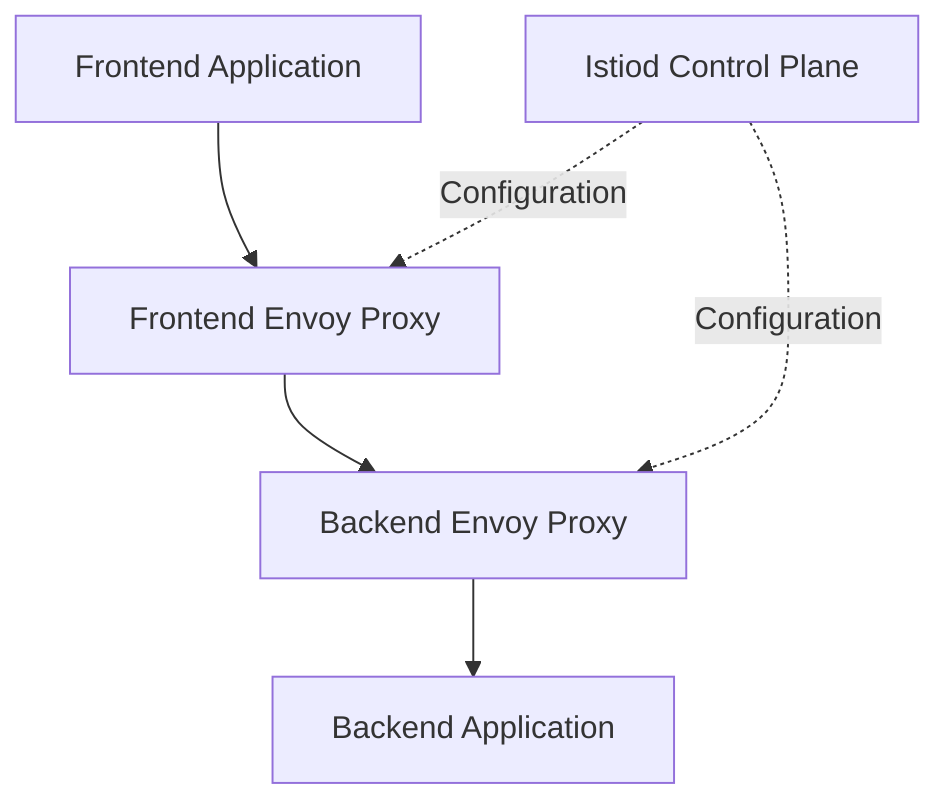

# Module 01: Service Mesh Fundamentals 🚀

Welcome to the first module of **Istio Zero to Hero**!

In this module, you will understand what a service mesh is, why modern microservices applications need one, and how Istio helps manage communication between services running on Kubernetes.

## 📚 Table of Contents

1. [What Is a Service Mesh?](#-what-is-a-service-mesh)
2. [Why Do We Need a Service Mesh?](#-why-do-we-need-a-service-mesh)
3. [Understanding Microservices Communication](#-understanding-microservices-communication)
4. [Problems Without a Service Mesh](#-problems-without-a-service-mesh)
5. [How Does a Service Mesh Work?](#-how-does-a-service-mesh-work)
6. [Service Mesh Architecture](#-service-mesh-architecture)
7. [East-West vs North-South Traffic](#-east-west-vs-north-south-traffic)
8. [Layer 4 vs Layer 7 Networking](#-layer-4-vs-layer-7-networking)
9. [Service Mesh vs Kubernetes Services](#-service-mesh-vs-kubernetes-services)
10. [Service Mesh vs Ingress Controller](#-service-mesh-vs-ingress-controller)
11. [Service Mesh vs API Gateway](#-service-mesh-vs-api-gateway)
12. [Istio vs Linkerd](#-istio-vs-linkerd)
13. [Benefits of a Service Mesh](#-benefits-of-a-service-mesh)
14. [Limitations of a Service Mesh](#-limitations-of-a-service-mesh)
15. [When Should You Use a Service Mesh?](#-when-should-you-use-a-service-mesh)
16. [Hands-On Lab](#-hands-on-lab)
17. [Key Takeaways](#-key-takeaways)
18. [Interview Questions](#-interview-questions)
19. [What's Next?](#-whats-next)

---

## 📌 What Is a Service Mesh?

A **service mesh** is an infrastructure layer that manages, secures, and observes communication between services in a distributed application.

In a microservices architecture, an application is divided into multiple independent services. These services communicate with each other over the network.

Managing communication, security, traffic routing, retries, and monitoring individually for every service becomes difficult as the application grows.

A service mesh provides a centralized and consistent way to manage these communication requirements without requiring developers to implement every capability inside their application code.

### Example

Consider an e-commerce application with the following microservices:

- Frontend Service
- Product Service
- Order Service
- Payment Service
- Notification Service

When a customer places an order, the frontend communicates with the order service, which may communicate with the payment and notification services.

A service mesh can help manage this communication by providing:

- Traffic routing and load balancing
- Service-to-service encryption
- Authentication and authorization
- Retries and request timeouts
- Traffic metrics, logs, and tracing integration

**In simple terms:** A service mesh manages how services communicate with one another.

---

## 🤔 Why Do We Need a Service Mesh?

In a small application with two or three services, managing communication manually may be straightforward.

However, in a large microservices application with dozens or hundreds of services, managing communication becomes more complex.

For example, imagine an application with 50 microservices.

Each service may need:

- Secure communication with other services
- Request timeouts and retry policies
- Traffic routing rules
- Monitoring and troubleshooting
- Authentication and access control

Implementing these features separately in every application leads to duplicated code, inconsistent policies, and additional maintenance.

A service mesh moves many of these communication responsibilities into the infrastructure layer.

### Without a Service Mesh

Each application may need to implement or configure its own communication logic.

### With a Service Mesh

A consistent set of traffic-management and security policies can be applied through the mesh infrastructure.

This allows developers to focus more on business logic while platform and operations teams manage service communication.

---

## 🔗 Understanding Microservices Communication

Microservices communicate over a network using protocols such as HTTP, HTTPS, gRPC, and TCP.

For example:

```text
                 E-Commerce Application

                    ┌───────────┐
                    │ Frontend  │
                    └─────┬─────┘
                          │
                    ┌─────▼─────┐
                    │  Product  │
                    │  Service  │
                    └───────────┘

                    ┌───────────┐
                    │  Order    │
                    │  Service  │
                    └─────┬─────┘
                          │
              ┌───────────┴───────────┐
              │                       │
        ┌─────▼─────┐          ┌──────▼─────┐
        │  Payment  │          │Notification│
        │  Service  │          │  Service   │
        └───────────┘          └────────────┘
```

In Kubernetes, these services commonly communicate through Kubernetes Services and their associated networking mechanisms.

As the number of services increases, controlling their communication becomes more difficult.

A service mesh adds capabilities that help manage this service-to-service traffic.

---

## ⚠️ Problems Without a Service Mesh

### 1. Traffic Management

You may need to route a percentage of requests to a new application version during a canary deployment.

Without a service mesh, you may need application-level logic or other traffic-management infrastructure.

### 2. Security

Services may communicate without transport encryption unless TLS is explicitly configured.

A service mesh can provide mutual TLS (mTLS) and policy-based service authentication.

### 3. Reliability

A downstream service may become temporarily unavailable or respond slowly.

Applications may need to implement timeouts, retries, and failure-handling logic. A service mesh can provide configurable network-level resilience features.

### 4. Observability

You may need to understand:

- Which service is generating errors
- How much traffic a service receives
- Which requests have high latency
- How requests move across multiple services

A service mesh can provide traffic metrics, access logs, and tracing integration.

### 5. Operational Complexity

When every service manages communication differently, troubleshooting and enforcing consistent policies becomes harder.

A service mesh provides common mechanisms for configuring and observing communication across workloads.

---

## ⚙️ How Does a Service Mesh Work?

Many service meshes use proxies to manage application traffic.

In the traditional Istio sidecar architecture, an Envoy proxy runs alongside each application Pod and handles applicable incoming and outgoing traffic.

Consider a frontend service communicating with a backend service.



The communication flow is:

1. The frontend application sends a request.
2. The frontend Envoy proxy handles the outgoing traffic.
3. The request travels to the backend Envoy proxy.
4. The backend proxy applies the relevant policies and forwards the request to the backend application.
5. The proxies generate telemetry about the communication.
6. Istio's control plane distributes configuration to the proxies.

The proxies handle application traffic, while the control plane configures and manages the mesh.

**Note:** Istio also supports ambient mesh, which can provide mesh functionality without injecting a sidecar into every application Pod.

---

## 🏗️ Service Mesh Architecture

A traditional sidecar-based service mesh consists of two major planes.

### 1. Control Plane

The control plane manages the service mesh configuration.

In Istio, the main control-plane component is **Istiod**.

Responsibilities include:

- Service discovery and configuration distribution
- Traffic-management configuration
- Workload identity and certificate management
- Security policy configuration
- Proxy configuration updates

### 2. Data Plane

The data plane handles actual application traffic.

In traditional Istio sidecar mode, it consists of Envoy proxies.

Responsibilities include:

- Routing requests
- Applying traffic-management rules
- Enforcing supported security policies
- Collecting traffic telemetry
- Implementing configured retries and timeouts

The control plane configures the data plane; the data plane handles the traffic.

You will explore this architecture in detail in [Module 02: Istio Architecture](../02-istio-architecture/README.md).

---

## 🌐 East-West vs North-South Traffic

### East-West Traffic

East-west traffic refers to communication between services inside a system or network environment.

Examples:

- Frontend to backend
- Order service to payment service
- One Kubernetes workload to another

Service meshes are especially useful for managing this type of service-to-service communication.

### North-South Traffic

North-south traffic refers to traffic entering or leaving the application environment.

Examples:

- A user accessing an application from the internet
- An external client calling an API
- A workload accessing an external API

An ingress gateway can manage incoming traffic, while an egress gateway can help control outgoing traffic.

| Feature | East-West | North-South |
|---|---|---|
| Direction | Between internal services | Into or out of the environment |
| Example | Frontend → Backend | Browser → Application |
| Common components | Workload proxies and service networking | Ingress and egress gateways |
| Main concerns | Service communication, identity, resilience | External access, TLS, routing, access control |

These are architectural terms rather than strict boundaries: traffic classification depends on the environment.

---

## 🧩 Layer 4 vs Layer 7 Networking

### Layer 4 — Transport Layer

Layer 4 networking primarily operates with transport protocols such as TCP.

It can use information such as source and destination addresses and ports to manage connections.

Examples:

- TCP connection handling
- Port-based routing
- TCP load balancing

### Layer 7 — Application Layer

Layer 7 networking understands application protocols such as HTTP.

It can make routing decisions based on application-level information.

Examples:

- URL path routing
- HTTP header-based routing
- HTTP request timeouts
- HTTP retries

| Feature | Layer 4 | Layer 7 |
|---|---|---|
| Typical protocol | TCP | HTTP, gRPC |
| Routing information | Addresses, ports, connections | Paths, headers, methods |
| Example | Route TCP traffic to port 8080 | Route `/payments` to a payment service |
| Application awareness | Limited | Higher |

Istio supports both Layer 4 and Layer 7 capabilities, depending on the protocol and configuration.

---

## ☸️ Service Mesh vs Kubernetes Services

A Kubernetes Service and a service mesh solve different problems.

A Kubernetes Service provides a stable network endpoint for a set of Pods and supports service discovery and traffic distribution.

A service mesh adds advanced communication-management capabilities.

| Feature | Kubernetes Service | Service Mesh |
|---|---|---|
| Service discovery | Yes | Uses and extends workload/service discovery |
| Stable network endpoint | Yes | Works with service endpoints |
| Basic traffic distribution | Yes | Supports advanced traffic policies |
| Canary traffic splitting | Not natively provided by a standard Service alone | Supported through mesh routing |
| mTLS management | Requires separate configuration or tooling | Supported by Istio |
| Application-level retries | Not provided by a standard Service | Configurable for supported protocols |
| Traffic telemetry | Basic Kubernetes networking visibility | Rich service-level telemetry |

**Important:** Kubernetes Services remain useful when a service mesh is installed. Istio does not replace Kubernetes Services.

---

## 🚪 Service Mesh vs Ingress Controller

An Ingress Controller manages incoming external HTTP/HTTPS traffic into a Kubernetes environment according to configured rules.

A service mesh manages communication between workloads and can also manage ingress and egress through gateways.

| Feature | Ingress Controller | Service Mesh |
|---|---|---|
| Primary purpose | External traffic entry | Service communication management |
| Internal service-to-service policies | Limited or implementation-specific | Core capability |
| Canary routing | Supported by some controllers | Supported |
| Service-to-service mTLS | Not its primary purpose | Supported |
| Traffic telemetry | Controller-dependent | Service-level telemetry |
| Scope | Primarily ingress traffic | Internal traffic and configured ingress/egress |

Istio can manage external traffic using gateways. You do not necessarily need a separate ingress controller for every use case.

---

## 🔌 Service Mesh vs API Gateway

An API gateway manages API access, often at the boundary between external clients and backend services.

It commonly handles authentication, rate limiting, API routing, request transformation, and other API-specific concerns.

A service mesh primarily manages communication between services, though it can also provide gateway capabilities.

| Feature | API Gateway | Service Mesh |
|---|---|---|
| Primary focus | API access and management | Service-to-service communication |
| External client authentication | Common capability | Can support authentication at gateways |
| API rate limiting | Depends on implementation and configuration | May require additional integration |
| Internal mTLS | Not its primary purpose | Supported |
| Internal traffic routing | Implementation-dependent | Core capability |
| Service-level telemetry | Gateway-dependent | Core capability |

They can complement one another in the same architecture.

---

## ⚖️ Istio vs Linkerd

Istio and Linkerd are both service mesh technologies for cloud-native applications.

| Feature | Istio | Linkerd |
|---|---|---|
| Main purpose | Service mesh for traffic management, security, and observability | Service mesh focused on simplicity, security, and observability |
| Proxy technology | Envoy in the traditional sidecar architecture | Linkerd's purpose-built proxy |
| Traffic management | Extensive routing and traffic policies | Supports common traffic-management features |
| Security | mTLS, workload identities, authorization policies | mTLS and policy-based security features |
| Deployment models | Sidecar and ambient | Uses its own architecture and deployment model |
| Complexity | Broad feature set with more operational concepts | Often emphasizes a simpler operational experience |

Choose based on application requirements, operational expertise, integrations, and the complexity you need to manage.

---

## ✅ Benefits of a Service Mesh

- **Centralized traffic management:** Apply consistent routing and resilience policies.
- **Improved security:** Use workload identities, mTLS, and authorization policies.
- **Better observability:** Collect service-level metrics, logs, and traces.
- **Application independence:** Implement many communication features without modifying application code.
- **Progressive delivery:** Support canary deployments and gradual traffic shifting.
- **Reliability:** Configure supported retries, timeouts, and fault-handling behavior.
- **Policy consistency:** Apply common communication policies across services.

---

## ⚠️ Limitations of a Service Mesh

- **Operational complexity:** Adds another infrastructure layer to understand and maintain.
- **Resource overhead:** Proxies and control-plane components consume CPU and memory.
- **Additional latency:** Proxy processing can add some network overhead.
- **Troubleshooting complexity:** Failures may involve applications, Kubernetes networking, proxies, certificates, or policies.
- **Configuration challenges:** Incorrect routing or security rules can disrupt service communication.
- **Upgrade management:** Control-plane and data-plane versions must be managed carefully.

A service mesh is not necessary for every application. Its value increases when the benefits justify the additional operational cost.

---

## 🎯 When Should You Use a Service Mesh?

A service mesh is worth evaluating when:

- Your application has many microservices.
- You need consistent service-to-service encryption.
- You require fine-grained workload authorization.
- You need advanced traffic splitting and canary releases.
- You need consistent retries, timeouts, and fault injection.
- You need better visibility into communication across services.
- Multiple teams need consistent networking and security policies.

For a small application with only a few services and basic networking requirements, Kubernetes Services and existing ingress infrastructure may be sufficient.

---

## 🧪 Hands-On Lab

### Objective

Deploy two simple applications on Kubernetes and observe how they communicate before installing Istio.

### Prerequisites

- A working Kubernetes cluster
- `kubectl` configured to access the cluster

You can use Kind, Minikube, or another Kubernetes environment.

### Step 1: Create a namespace

```bash
kubectl create namespace service-mesh-lab
```

### Step 2: Deploy a backend application

Save the following as `backend.yaml`:

```yaml
apiVersion: apps/v1
kind: Deployment
metadata:
  name: backend
  namespace: service-mesh-lab
spec:
  replicas: 1
  selector:
    matchLabels:
      app: backend
  template:
    metadata:
      labels:
        app: backend
    spec:
      containers:
        - name: backend
          image: hashicorp/http-echo:1.0.0
          args:
            - "-text=Hello from Backend"
          ports:
            - containerPort: 5678
---
apiVersion: v1
kind: Service
metadata:
  name: backend
  namespace: service-mesh-lab
spec:
  selector:
    app: backend
  ports:
    - port: 5678
      targetPort: 5678
```

Apply the manifest:

```bash
kubectl apply -f backend.yaml
```

### Step 3: Verify the backend

```bash
kubectl get pods -n service-mesh-lab
kubectl get svc -n service-mesh-lab
kubectl get endpointslice -n service-mesh-lab
```

Wait until the backend Pod is ready before continuing.

### Step 4: Send a request to the backend

```bash
kubectl run client \
  -n service-mesh-lab \
  --image=curlimages/curl:8.12.1 \
  --restart=Never \
  --command -- sleep 3600
```

Wait until the client Pod is ready, then run:

```bash
kubectl exec -n service-mesh-lab client -- \
  curl -s http://backend:5678
```

Expected output:

```text
Hello from Backend
```

### Step 5: Inspect the communication

Run:

```bash
kubectl get pods -n service-mesh-lab -o wide
kubectl get svc -n service-mesh-lab
kubectl get endpointslice -n service-mesh-lab
```

Observe how the client accesses the backend using the Kubernetes Service name instead of a specific Pod IP.

### Step 6: Clean up

```bash
kubectl delete namespace service-mesh-lab
```

### Lab Questions

1. Why does the client use the Service name instead of the Pod IP?
2. What happens if the backend Pod is recreated with a different IP?
3. Does a standard Kubernetes Service automatically provide mTLS?
4. Does a standard Kubernetes Service provide HTTP path-based canary routing?
5. What additional capabilities could Istio provide for this communication?

**Lab outcome:** You should understand basic Kubernetes service-to-service communication and be ready to explore how Istio extends it.

---

## 📝 Key Takeaways

- A service mesh manages communication between distributed application services.
- Istio provides traffic management, security, and observability capabilities.
- The control plane configures the mesh, while the data plane handles application traffic.
- Kubernetes Services remain important even when Istio is installed.
- An ingress controller and an API gateway have related but distinct responsibilities.
- East-west traffic generally describes internal service communication; north-south traffic describes traffic entering or leaving the environment.
- A service mesh introduces additional operational complexity and should be adopted when its capabilities justify the overhead.

---

## 🎤 Interview Questions

1. What is a service mesh?
2. Why do we need Istio when Kubernetes already provides Services?
3. What are the main components of Istio architecture?
4. What is the difference between the control plane and data plane?
5. What is an Envoy proxy?
6. What is the difference between east-west and north-south traffic?
7. What is the difference between Layer 4 and Layer 7 routing?
8. What is the difference between a service mesh and an ingress controller?
9. What is the difference between an API gateway and a service mesh?
10. How does a service mesh implement mTLS?
11. What are the benefits and limitations of a service mesh?
12. When would you choose not to deploy a service mesh?
13. What is the difference between Istio and Linkerd?
14. Does Istio replace Kubernetes Services?
15. What is the difference between sidecar and ambient mesh architectures?

---

## ➡️ What's Next?

Proceed to **[Module 02: Istio Architecture](../02-istio-architecture/README.md)** to learn about Istiod, Envoy, the control plane, the data plane, service discovery, and how Istio distributes configuration to proxies.

### 📖 References

- [Istio Official Documentation](https://istio.io/latest/docs/)
- [Istio Architecture](https://istio.io/latest/docs/ops/deployment/architecture/)
- [Istio Traffic Management](https://istio.io/latest/docs/concepts/traffic-management/)
- [Istio Security](https://istio.io/latest/docs/concepts/security/)
- [Istio Ambient Mesh](https://istio.io/latest/docs/ambient/)

---
