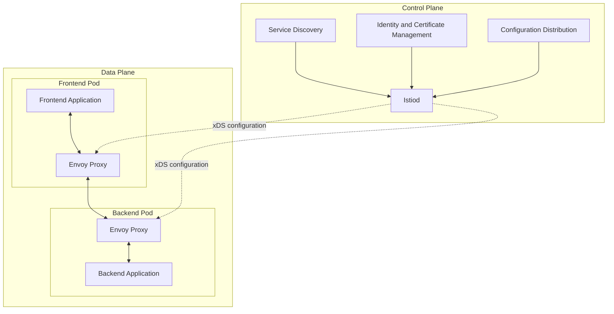
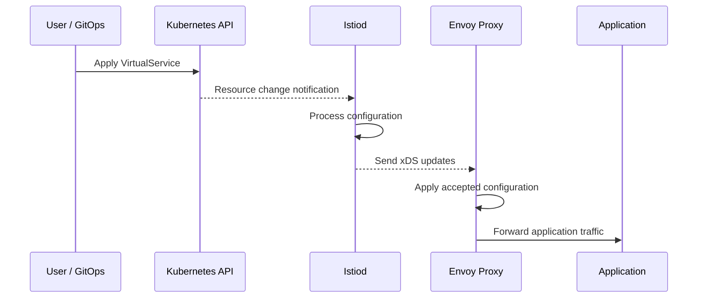
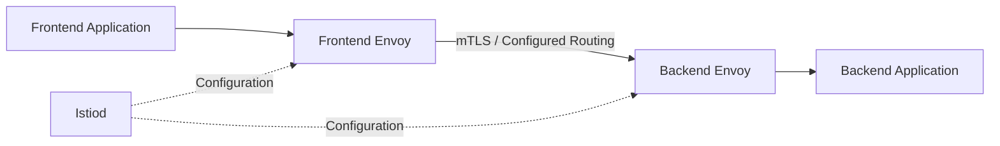

# Module 02: Istio Architecture 🏗️

Welcome to **Module 02 of Istio Zero to Hero!**

In this module, you will learn how Istio works internally, how its control plane manages the data plane, how Envoy proxies handle application traffic, and how configuration is distributed across workloads.

Understanding Istio architecture is essential before moving on to traffic management, security, observability, and production deployments.

---

## 📚 Table of Contents

1. [Istio Architecture Overview](#-istio-architecture-overview)
2. [Control Plane vs Data Plane](#-control-plane-vs-data-plane)
3. [What Is Istiod?](#-what-is-istiod)
4. [What Is Envoy Proxy?](#-what-is-envoy-proxy)
5. [How Istiod and Envoy Communicate](#-how-istiod-and-envoy-communicate)
6. [Understanding the xDS APIs](#-understanding-the-xds-apis)
7. [How Istio Discovers Services](#-how-istio-discovers-services)
8. [Sidecar Injection and Traffic Interception](#-sidecar-injection-and-traffic-interception)
9. [Workload Identity and Certificate Management](#-workload-identity-and-certificate-management)
10. [Istio Traffic Flow](#-istio-traffic-flow)
11. [Istio Configuration Resources](#-istio-configuration-resources)
12. [Istio Sidecar vs Ambient Architecture](#-istio-sidecar-vs-ambient-architecture)
13. [Exploring Istio Architecture Using kubectl](#-exploring-istio-architecture-using-kubectl)
14. [Troubleshooting Istio Architecture](#-troubleshooting-istio-architecture)
15. [Key Takeaways](#-key-takeaways)
16. [Interview Questions](#-interview-questions)
17. [What's Next?](#-whats-next)

---

## 🏗️ Istio Architecture Overview

Istio is an open-source service mesh that provides traffic management, security, and observability for distributed applications.

Its architecture separates responsibilities into two main parts:

- **Control plane:** Configures and manages the service mesh.
- **Data plane:** Handles application traffic and applies the configuration supplied by the control plane.

In the traditional sidecar architecture, Envoy proxies form the data plane, while Istiod is the primary control-plane component.

### Architecture diagram



### How it works

1. You deploy application workloads on Kubernetes.
2. Istio discovers workloads and services through its integration with the Kubernetes API and other configured service registries.
3. Istiod generates the required proxy configuration.
4. Istiod distributes configuration to the relevant Envoy proxies.
5. Envoy proxies use this configuration to route traffic and enforce applicable security policies.
6. The proxies produce telemetry such as request metrics and access logs.

**Important:** Istiod generally does not sit in the request path for every application request. Envoy handles application traffic in the sidecar architecture.

---

## ⚖️ Control Plane vs Data Plane

### Control Plane

The control plane manages the configuration and operation of the mesh.

In Istio, Istiod provides the primary control-plane functionality.

Its responsibilities include:

- Discovering services and workloads.
- Translating Istio configuration into proxy configuration.
- Distributing configuration to Envoy.
- Managing workload identities and certificates.
- Supporting traffic-management and security configuration.

### Data Plane

The data plane handles the actual communication between workloads.

In sidecar mode, Envoy proxies provide the data-plane functionality.

Their responsibilities include:

- Routing application requests.
- Applying configured load-balancing policies.
- Enforcing supported authentication and authorization policies.
- Applying configured timeouts, retries, and connection controls.
- Collecting request metrics and access logs.

### Comparison

| Feature | Control Plane | Data Plane |
|---|---|---|
| Main component | Istiod | Envoy proxies in sidecar mode |
| Primary responsibility | Manage and configure the mesh | Handle application traffic |
| Processes ordinary application requests | No, not in the normal request path | Yes |
| Service discovery | Discovers workloads and supplies configuration | Uses configured endpoints |
| Traffic management | Distributes routing configuration | Applies routing decisions |
| Security | Manages identities, certificates, and configuration | Enforces applicable security policies |
| Telemetry | Configures telemetry behavior | Generates traffic telemetry |
| Example | Configure a 90/10 canary deployment | Routes requests according to those weights |

### Real-world example

Suppose you want to route 90% of requests to application v1 and 10% to v2.

1. You create a `VirtualService` defining the traffic split.
2. Istiod processes the configuration.
3. Istiod sends the corresponding configuration to the relevant Envoy proxies.
4. Envoy proxies route requests according to the configured weights.

The control plane defines and distributes the configuration; the data plane applies it.

---

## 🧠 What Is Istiod?

**Istiod is the primary control-plane component of Istio.**

It consolidates several control-plane responsibilities into one component rather than requiring separate services for every function.

### Main responsibilities

**1. Service discovery**

Istiod obtains information about services, endpoints, and workloads from Kubernetes and other supported registries.

**2. Configuration management**

Istiod processes Istio resources such as:

- `VirtualService`
- `DestinationRule`
- `Gateway`
- `PeerAuthentication`
- `AuthorizationPolicy`

It translates relevant configuration into the proxy configuration needed by the data plane.

**3. Configuration distribution**

Istiod distributes configuration dynamically to connected Envoy proxies using the xDS APIs.

This usually avoids requiring application Pods or proxies to restart whenever a supported configuration change is made.

**4. Certificate management**

Istiod participates in workload identity and certificate issuance and rotation, enabling secure workload communication.

**5. Policy configuration**

Istiod distributes the relevant routing and security configuration so that data-plane proxies can apply it.

### What happens when Istiod is unavailable?

Existing Envoy proxies can generally continue processing traffic using their last accepted configuration, provided the required proxies, endpoints, certificates, and other dependencies remain usable.

However, new configuration updates, newly discovered endpoints, and certificate operations may be affected.

This is why production deployments should consider control-plane availability and monitoring.

---

## 🚀 What Is Envoy Proxy?

Envoy is a high-performance proxy designed for cloud-native applications and distributed systems.

Istio uses Envoy as the primary proxy in its traditional sidecar data plane.

### Main responsibilities

- HTTP, HTTP/2, gRPC, and supported TCP traffic handling.
- Layer 4 and Layer 7 traffic management.
- Load balancing across configured endpoints.
- Applying configured timeouts and retries.
- TLS and mTLS connections.
- Enforcing supported authorization policies.
- Collecting metrics and access logs.
- Supporting distributed tracing.

### Example

Imagine the frontend application sends a request to:

```text
http://backend:8080/orders
```

In a typical sidecar deployment, the request is intercepted and processed by the frontend's Envoy proxy according to the mesh configuration.

The proxy may then route the request securely to an appropriate backend endpoint.

The backend's proxy receives the traffic and forwards it to the backend application.

### Why use a proxy?

Without a proxy-based approach, applications would need to implement many networking, security, and observability features themselves.

Envoy allows much of this behavior to be managed outside the application's business logic.

---

## 🔄 How Istiod and Envoy Communicate

Istiod and Envoy communicate using APIs from the **xDS family**, which support dynamic configuration updates.

The control plane sends configuration to proxies, and proxies report their status and request configuration as needed.

### Configuration flow



This diagram represents a simplified configuration flow. Exact update behavior depends on the resource, proxy state, and Istio version.

### Important points

- Configuration updates are normally dynamic.
- Istiod uses xDS to communicate with Envoy.
- Envoy maintains its active configuration and can report synchronization status.
- An invalid configuration may be rejected or may not produce the intended routing behavior.
- A configuration change does not necessarily require an application restart.

---

## 📡 Understanding the xDS APIs

xDS refers to a family of APIs used to dynamically configure Envoy proxies.

| API | Full name | Purpose |
|---|---|---|
| LDS | Listener Discovery Service | Configures listeners that accept connections |
| RDS | Route Discovery Service | Supplies HTTP routing configuration |
| CDS | Cluster Discovery Service | Configures upstream clusters |
| EDS | Endpoint Discovery Service | Supplies endpoints for clusters |
| SDS | Secret Discovery Service | Supplies TLS certificates and related secrets |

### Simple example

Suppose an Envoy proxy must route requests to a backend service.

- LDS determines which listeners accept traffic.
- RDS determines how HTTP requests should be routed.
- CDS describes the upstream cluster.
- EDS provides the endpoints that belong to that cluster.
- SDS supplies applicable certificate and TLS secret information.

Not every workload or connection requires every API type.

**Remember:** xDS is the mechanism through which Envoy receives dynamic configuration; it is not a Kubernetes resource.

---

## 🔎 How Istio Discovers Services

Istio needs to know which workloads and endpoints are available before configuring traffic routing.

On Kubernetes, Istiod integrates with the Kubernetes API to obtain service, Pod, and endpoint information.

For example, a Kubernetes Service might look like this:

```yaml
apiVersion: v1
kind: Service
metadata:
  name: backend
  namespace: ecommerce
spec:
  selector:
    app: backend
  ports:
    - name: http
      port: 8080
      targetPort: 8080
```

Suppose three backend Pods match the Service selector.

Kubernetes maintains endpoint information for those Pods. Istio can use the discovered workload and endpoint information to configure the relevant proxies.

### Important distinction

- **Kubernetes Service:** Provides a stable service abstraction and endpoint selection.
- **Istiod:** Discovers workloads and distributes mesh configuration.
- **Envoy:** Uses its configuration to route requests and apply traffic policies.

Istio does not replace Kubernetes service discovery. It builds on Kubernetes and extends it with service-mesh capabilities.

---

## 📦 Sidecar Injection and Traffic Interception

In the traditional sidecar architecture, an Envoy proxy runs alongside the application container in the same Pod.

### Example Pod structure

```text
Frontend Pod
├── frontend-container
└── istio-proxy-container
```

The `istio-proxy` container runs Envoy.

### Automatic sidecar injection

When automatic injection is enabled for a namespace, Istio's admission webhook can modify newly created application Pods to include the sidecar container.

For example:

```bash
kubectl label namespace ecommerce istio-injection=enabled
```

This is the classic sidecar-injection label. Confirm the injection configuration used by your chosen Istio installation before applying it.

Restart or recreate existing application Pods when needed, because adding the label does not retroactively inject proxies into already-running Pods.

### Inspect an injected Pod

```bash
kubectl get pods -n ecommerce
```

```bash
kubectl get pod <pod-name> -n ecommerce \
  -o jsonpath='{.spec.containers[*].name}'
```

An injected Pod commonly includes the application container and `istio-proxy`.

### How is traffic intercepted?

In typical sidecar mode, Istio configures traffic redirection using networking rules, often through iptables or the Istio CNI plugin.

This redirects applicable traffic through Envoy without requiring the application to explicitly send requests to the proxy.

Exact interception behavior depends on the installation, traffic exclusions, and networking configuration.

---

## 🔐 Workload Identity and Certificate Management

Istio can establish identities for workloads and use certificates to secure communication between them.

### Workload identity

A workload identity identifies a workload independently of its current Pod IP address.

In Kubernetes, Istio commonly derives workload identity from the service account associated with the workload.

An example identity is:

```text
cluster.local/ns/ecommerce/sa/frontend
```

This represents a workload identity in the `cluster.local` trust domain, within the `ecommerce` namespace, using the `frontend` service account.

### Certificate management

Istio's certificate infrastructure supports secure workload communication.

At a high level:

1. A workload proxy requests credentials for its workload identity.
2. Istio's certificate infrastructure validates the request according to the configured trust and authentication model.
3. A workload certificate and associated key material are provisioned.
4. Envoy uses the credentials to establish authenticated TLS connections when required.
5. Certificates are rotated as they approach expiration.

### What is mTLS?

Mutual TLS authenticates both ends of a connection using certificates and establishes encrypted communication.

With Istio mTLS:

- The client workload authenticates the server workload.
- The server workload authenticates the client workload.
- Traffic is encrypted in transit.
- Identity information can be used with authorization policies.

**Important:** Having Istio installed does not automatically mean every workload is enforcing strict mTLS. The effective security configuration must be verified.

---

## 🔀 Istio Traffic Flow

Consider a frontend application communicating with a backend application in sidecar mode.



### Step-by-step flow

1. The frontend application sends an HTTP request.
2. Traffic interception directs applicable outgoing traffic to the frontend Envoy.
3. Envoy evaluates its active listener, route, cluster, endpoint, and security configuration.
4. The proxy forwards the request toward an eligible backend endpoint.
5. If mTLS is configured and required, the proxies establish authenticated encrypted communication.
6. The backend Envoy receives the request and forwards it to the backend application.
7. The proxies produce telemetry for monitoring and troubleshooting.

Istiod supplies configuration separately from the ordinary request flow.

### What if a backend Pod is replaced?

When Kubernetes endpoint information changes, Istio can update the relevant proxy configuration. Envoy can then route requests to the currently eligible endpoints without requiring the application to know their Pod IP addresses.

---

## 🧩 Istio Configuration Resources

Istio extends Kubernetes through custom resource definitions (CRDs).

These resources let users define routing, security, and other mesh behavior declaratively.

| Resource | Purpose |
|---|---|
| `VirtualService` | Defines traffic-routing rules |
| `DestinationRule` | Defines destination policies and subsets |
| `Gateway` | Configures traffic entering or leaving through an Istio gateway |
| `ServiceEntry` | Adds external or otherwise non-mesh service information to Istio's registry |
| `PeerAuthentication` | Defines workload-level peer authentication, including mTLS mode |
| `RequestAuthentication` | Configures supported request authentication, such as JWT validation |
| `AuthorizationPolicy` | Defines access-control rules |
| `Telemetry` | Configures supported telemetry behavior |

These resources are stored through the Kubernetes API. Istiod watches and processes relevant configuration, then distributes the corresponding proxy configuration.

You will learn how to configure each resource in later modules.

---

## 🌐 Istio Sidecar vs Ambient Architecture

Istio supports more than one data-plane deployment model.

### Sidecar architecture

Each enrolled application Pod has an Envoy sidecar proxy.

```text
Application Pod
├── Application Container
└── Envoy Sidecar
```

The sidecar handles applicable traffic for that workload.

### Ambient architecture

Ambient mesh avoids injecting a sidecar into every application Pod.

Its key components include:

- **ztunnel:** Provides core Layer 4 connectivity and security capabilities.
- **Waypoint proxy:** Provides Layer 7 functionality for workloads when configured.

```text
Application Pod
       |
       v
    ztunnel
       |
       v
Waypoint Proxy (when required)
```

This is a simplified conceptual diagram, not a complete ambient network topology.

### Comparison

| Feature | Sidecar Mode | Ambient Mode |
|---|---|---|
| Per-Pod Envoy sidecar | Yes | No |
| Core Layer 4 mesh security | Via sidecar proxy | Via ztunnel |
| Layer 7 features | Via Envoy sidecar | Via waypoint when required |
| Per-workload proxy overhead | Sidecar resources per Pod | Different resource and operational model |
| Traffic interception | Sidecar redirection | Ambient networking mechanisms |

Both models provide service-mesh capabilities, but their architecture, resource requirements, and operational workflows differ.

---

## 🧪 Exploring Istio Architecture Using kubectl

Complete these exercises on a Kubernetes cluster where Istio is installed.

### Step 1: Inspect the Istio namespace

```bash
kubectl get pods -n istio-system
kubectl get services -n istio-system
```

Look for the Istiod deployment and the components enabled by your installation profile.

### Step 2: Inspect Istio custom resources

```bash
kubectl get crd | grep 'istio.io'
```

This lists installed Istio CRDs.

### Step 3: Inspect application Pods

```bash
kubectl get pods -A
```

Find a namespace containing an injected application Pod.

### Step 4: Inspect container names

```bash
kubectl get pod <pod-name> -n <namespace> \
  -o jsonpath='{.spec.containers[*].name}'
```

Identify the `istio-proxy` container.

### Step 5: Inspect proxy synchronization

```bash
istioctl proxy-status
```

This reports the synchronization status of proxies known to Istio.

### Step 6: Analyze the mesh configuration

```bash
istioctl analyze -A
```

This can help identify certain configuration issues and warnings.

### Step 7: Inspect proxy configuration

```bash
istioctl proxy-config listeners <pod-name> -n <namespace>
```

Inspect the clusters configured in the proxy:

```bash
istioctl proxy-config clusters <pod-name> -n <namespace>
```

Inspect routes where applicable:

```bash
istioctl proxy-config routes <pod-name> -n <namespace>
```

These commands help you understand what the data plane has actually received rather than relying only on the YAML you applied.

---

## 🛠️ Troubleshooting Istio Architecture

### Problem 1: The `istio-proxy` container is missing

Possible causes:

- Sidecar injection is not enabled for the namespace.
- The Pod was created before injection was enabled.
- The injection webhook or its configuration has a problem.
- The workload uses ambient mode instead of sidecar mode.

Useful commands:

```bash
kubectl get namespace --show-labels
kubectl describe pod <pod-name> -n <namespace>
```

### Problem 2: Proxy configuration is not synchronized

Check:

```bash
istioctl proxy-status
kubectl logs -n istio-system deploy/istiod
```

Investigate connectivity to Istiod, rejected configuration, proxy connectivity, and version compatibility.

### Problem 3: Application traffic fails

Check the application and proxy logs:

```bash
kubectl logs <pod-name> -n <namespace> -c istio-proxy
```

Inspect configured endpoints:

```bash
istioctl proxy-config endpoints <pod-name> -n <namespace>
```

Also verify Kubernetes Service selectors, EndpointSlices, routing policies, and effective security settings.

### Problem 4: mTLS communication fails

Possible causes include:

- Incompatible peer-authentication and destination TLS settings.
- Missing or invalid workload credentials.
- Incorrect authorization policies.
- Network connectivity or certificate issues.

Useful command:

```bash
istioctl x describe pod <pod-name> -n <namespace>
```

The exact diagnostics available depend on your Istio version and workload configuration.

---

## 📝 Key Takeaways

- Istio architecture separates control-plane management from data-plane traffic handling.
- Istiod is the primary control-plane component.
- Envoy is the primary proxy in the traditional sidecar data plane.
- xDS APIs distribute dynamic configuration to proxies.
- Kubernetes supplies service and workload information that Istio uses for service discovery.
- Sidecar injection adds Envoy to application Pods when enabled.
- Workload identities and certificates support secure service communication.
- Istio configuration resources define routing, authentication, and authorization behavior.
- Ambient mode uses ztunnel and, when required, waypoint proxies instead of a sidecar in every application Pod.
- `istioctl` is an important tool for inspecting and troubleshooting the mesh.

---

## 🎤 Interview Questions

1. Explain the architecture of Istio.
2. What is the difference between the control plane and data plane?
3. What is Istiod, and what are its responsibilities?
4. What is Envoy Proxy?
5. Does Istiod handle every application request?
6. How do Istiod and Envoy communicate?
7. What are the xDS APIs?
8. What are LDS, RDS, CDS, EDS, and SDS?
9. How does Istio discover Kubernetes services?
10. What is sidecar injection?
11. How does Istio intercept application traffic?
12. What is a workload identity?
13. How does Istio issue and rotate workload certificates?
14. What is mTLS, and how does it work in Istio?
15. What happens if Istiod becomes unavailable?
16. What happens when a backend Pod is replaced?
17. How would you troubleshoot an Envoy proxy that is not synchronized?
18. What is the difference between sidecar and ambient mesh?
19. What are Istio CRDs?
20. How would you investigate a service returning HTTP 503?

---

## ➡️ What's Next?

Continue to **[Module 03: Installing Istio](../03-installing-istio/README.md)**.

In the next module, you will install Istio using `istioctl` and Helm, explore installation profiles, enable sidecar injection, validate the installation, and prepare a Kubernetes environment for hands-on service mesh labs.

### 📖 References

- [Istio Documentation](https://istio.io/latest/docs/)
- [Istio Architecture](https://istio.io/latest/docs/ops/deployment/architecture/)
- [Istio Control Plane](https://istio.io/latest/docs/ops/deployment/architecture/#istiod)
- [Envoy Proxy Documentation](https://www.envoyproxy.io/docs/envoy/latest/)
- [Istio Security Concepts](https://istio.io/latest/docs/concepts/security/)
- [Istio Ambient Mesh](https://istio.io/latest/docs/ambient/)
- [istioctl Reference](https://istio.io/latest/docs/reference/commands/istioctl/)

---
