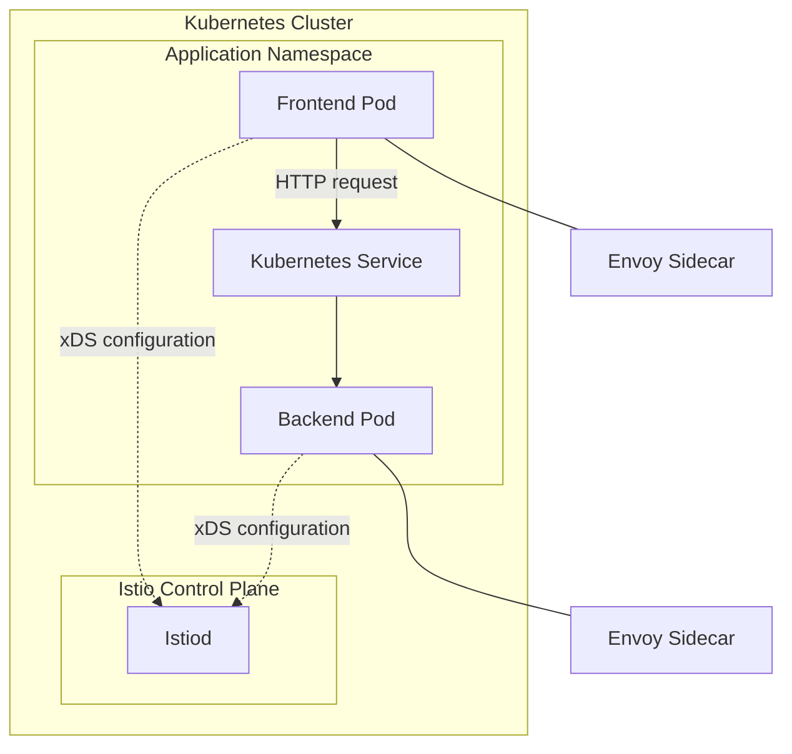

# 12. Istio and Kubernetes Integration

Learn how Istio integrates with Kubernetes to provide service-to-service communication, traffic management, security, and observability for containerized applications.

This module focuses on integrating Istio with native Kubernetes resources and understanding how both systems work together in real-world environments.

## Table of Contents

- [Learning Objectives](#learning-objectives)
- [1. How Istio Integrates with Kubernetes](#1-how-istio-integrates-with-kubernetes)
- [2. Kubernetes Resources Used by Istio](#2-kubernetes-resources-used-by-istio)
- [3. Automatic Sidecar Injection](#3-automatic-sidecar-injection)
- [4. Deploy an Application with Istio](#4-deploy-an-application-with-istio)
- [5. Kubernetes Services and Istio](#5-kubernetes-services-and-istio)
- [6. ConfigMaps and Secrets](#6-configmaps-and-secrets)
- [7. Health Probes and Istio](#7-health-probes-and-istio)
- [8. Resource Requests and Limits](#8-resource-requests-and-limits)
- [9. Kubernetes Gateway API Integration](#9-kubernetes-gateway-api-integration)
- [10. Namespace-Level Integration](#10-namespace-level-integration)
- [11. Troubleshooting](#11-troubleshooting)
- [12. Hands-On Labs](#12-hands-on-labs)
- [13. Best Practices](#13-best-practices)
- [14. Interview Questions](#14-interview-questions)
- [Official Resources](#official-resources)
- [Next Module](#next-module)

## Learning Objectives

By the end of this module, you should understand:

- How Istio extends Kubernetes networking.
- How Istio sidecars are injected into application Pods.
- How Kubernetes Services work with Istio.
- How Deployments, namespaces, ConfigMaps, and Secrets integrate with Istio.
- How to configure application health probes and resource limits.
- How to use Kubernetes Gateway API with Istio.
- How to troubleshoot integration problems.

## 1. How Istio Integrates with Kubernetes

Kubernetes manages containerized workloads, while Istio adds service mesh capabilities to communication between workloads.

Kubernetes provides:

- Pod scheduling and lifecycle management.
- Deployments, StatefulSets, and ReplicaSets.
- Services and service discovery.
- ConfigMaps, Secrets, and resource management.

Istio provides:

- Service-to-service traffic management.
- Mutual TLS (mTLS).
- Authorization policies.
- Traffic shifting, retries, and timeouts.
- Metrics, distributed tracing, and access logs.

### Architecture



In sidecar mode, Istio injects an Envoy proxy into eligible application Pods. The proxies handle configured traffic policies, while Istiod distributes configuration and manages workload identity and certificates.

**Important:** Kubernetes Services still provide service discovery and stable endpoints. Istio adds mesh-aware traffic handling; it does not replace Kubernetes.

## 2. Kubernetes Resources Used by Istio

| Kubernetes resource | Role in Istio integration |
|---|---|
| Namespace | Controls injection labels and provides a policy scope |
| Pod | Runs the application and, in sidecar mode, Envoy |
| Deployment | Manages application replicas and rollouts |
| Service | Provides stable service discovery and networking |
| ServiceAccount | Supplies workload identity context |
| ConfigMap | Stores non-sensitive application configuration |
| Secret | Stores sensitive values such as TLS credentials |
| Gateway | Can be used with Kubernetes Gateway API to configure entry traffic |
| NetworkPolicy | Controls network-level connectivity when supported by the cluster's CNI |

Istio also introduces custom resources such as `VirtualService`, `DestinationRule`, `PeerAuthentication`, and `AuthorizationPolicy`.

Check the available Istio custom resources:

```bash
kubectl get crds | grep 'istio.io'
```

## 3. Automatic Sidecar Injection

Automatic sidecar injection adds an Envoy container to eligible Pods when they are created.

### Step 1: Label a namespace

```bash
kubectl create namespace istio-k8s
kubectl label namespace istio-k8s istio-injection=enabled
```

### Step 2: Deploy an application

Create `deployment.yaml`:

```yaml
apiVersion: apps/v1
kind: Deployment
metadata:
  name: nginx
  namespace: istio-k8s
spec:
  replicas: 2
  selector:
    matchLabels:
      app: nginx
  template:
    metadata:
      labels:
        app: nginx
    spec:
      containers:
        - name: nginx
          image: nginx:1.27
          ports:
            - containerPort: 80
```

Apply the manifest:

```bash
kubectl apply -f deployment.yaml
kubectl rollout status deployment/nginx -n istio-k8s
kubectl get pods -n istio-k8s
```

In sidecar mode, a successfully injected Pod normally shows `2/2` in the `READY` column: one application container and one Envoy container.

### Step 3: Verify the sidecar

```bash
kubectl get pods -n istio-k8s
kubectl describe pod -n istio-k8s <pod-name>
kubectl get pod -n istio-k8s <pod-name> \
  -o jsonpath='{.spec.containers[*].name}'
```

Expected container names include:

```text
nginx istio-proxy
```

### Important points

- Injection happens when a Pod is created, not by modifying an existing running Pod.
- Existing Pods may need to be recreated after enabling injection.
- The namespace label enables injection only when the Istio injector is installed and functioning.
- Ambient mesh uses a different data-plane model and does not require an Envoy sidecar in every application Pod.

Official guide: [Installing the Istio Sidecar](https://istio.io/latest/docs/setup/additional-setup/sidecar-injection/)

## 4. Deploy an Application with Istio

Let's deploy a frontend that sends requests to a backend through a Kubernetes Service.

### Step 1: Create the backend Deployment and Service

Create `backend.yaml`:

```yaml
apiVersion: apps/v1
kind: Deployment
metadata:
  name: backend
  namespace: istio-k8s
spec:
  replicas: 2
  selector:
    matchLabels:
      app: backend
  template:
    metadata:
      labels:
        app: backend
        version: v1
    spec:
      containers:
        - name: backend
          image: hashicorp/http-echo:1.0.0
          args:
            - "-listen=:5678"
            - "-text=Hello from Istio backend"
          ports:
            - containerPort: 5678
---
apiVersion: v1
kind: Service
metadata:
  name: backend
  namespace: istio-k8s
spec:
  selector:
    app: backend
  ports:
    - name: http
      port: 80
      targetPort: 5678
```

Apply it:

```bash
kubectl apply -f backend.yaml
```

### Step 2: Create a frontend Pod

Create `frontend.yaml`:

```yaml
apiVersion: v1
kind: Pod
metadata:
  name: frontend
  namespace: istio-k8s
  labels:
    app: frontend
spec:
  containers:
    - name: curl
      image: curlimages/curl:8.10.1
      command: ["sh", "-c", "sleep 36000"]
```

Apply the manifest:

```bash
kubectl apply -f frontend.yaml
kubectl wait --for=condition=Ready pod/frontend \
  -n istio-k8s --timeout=120s
```

### Step 3: Test service communication

```bash
kubectl exec -n istio-k8s frontend -c curl -- \
  curl -sS http://backend.istio-k8s.svc.cluster.local
```

Expected response:

```text
Hello from Istio backend
```

The request uses Kubernetes DNS to resolve the backend Service. When the workloads participate in the Istio mesh, Istio can apply its configured traffic and security policies to eligible traffic.

## 5. Kubernetes Services and Istio

Kubernetes Services provide stable names and endpoints for workloads. Istio uses service information from Kubernetes to configure mesh proxies.

### Service types

| Service type | Purpose |
|---|---|
| ClusterIP | Internal cluster communication |
| NodePort | Exposes a Service through a port on cluster nodes |
| LoadBalancer | Requests an external load balancer where the environment supports it |
| ExternalName | Maps a Service name to an external DNS name |

For typical microservice communication, `ClusterIP` is commonly used.

### Inspect Services and endpoints

```bash
kubectl get svc -n istio-k8s
kubectl get endpointslice -n istio-k8s
kubectl describe svc backend -n istio-k8s
```

Check that the Service selector matches the backend Pod labels.

### Istio traffic management

Istio resources can apply advanced routing on top of Kubernetes Services.

For example, a `VirtualService` can route traffic to different backend versions, while a `DestinationRule` defines subsets and connection policies.

```yaml
apiVersion: networking.istio.io/v1
kind: DestinationRule
metadata:
  name: backend
  namespace: istio-k8s
spec:
  host: backend
  subsets:
    - name: v1
      labels:
        version: v1
```

The subset only works if the selected backend Pods carry the matching `version: v1` label. A `VirtualService` must reference the subset to direct traffic to it.

## 6. ConfigMaps and Secrets

Applications often need configuration and credentials. Kubernetes provides ConfigMaps and Secrets, and those resources can be consumed by workloads running in an Istio mesh.

### ConfigMap example

```yaml
apiVersion: v1
kind: ConfigMap
metadata:
  name: backend-config
  namespace: istio-k8s
data:
  APP_ENV: development
  LOG_LEVEL: info
```

Reference it from a container:

```yaml
envFrom:
  - configMapRef:
      name: backend-config
```

### Secret example

Create a generic Secret for a lab:

```bash
kubectl create secret generic backend-secret \
  --namespace istio-k8s \
  --from-literal=API_KEY='replace-with-a-lab-value'
```

Reference it as an environment variable:

```yaml
env:
  - name: API_KEY
    valueFrom:
      secretKeyRef:
        name: backend-secret
        key: API_KEY
```

**Security note:** Kubernetes Secrets are not automatically encrypted merely because they are represented as Secret objects. Configure encryption at rest, restrict RBAC access, and avoid committing credentials to Git. For production TLS credentials used by an Istio gateway, follow the appropriate gateway TLS configuration and Secret placement requirements.

## 7. Health Probes and Istio

Kubernetes uses health probes to determine whether containers are alive and ready to receive traffic.

- **Liveness probe:** Detects whether a container should be restarted.
- **Readiness probe:** Determines whether a container should receive traffic.
- **Startup probe:** Gives slow-starting applications additional time to initialize.

Example:

```yaml
readinessProbe:
  httpGet:
    path: /
    port: 80
  initialDelaySeconds: 5
  periodSeconds: 10
livenessProbe:
  httpGet:
    path: /
    port: 80
  initialDelaySeconds: 15
  periodSeconds: 20
```

Istio's sidecar traffic interception can affect how some application probes are handled. Istio supports probe rewriting for eligible HTTP, TCP, and gRPC probes so that kubelet health checks continue to work with sidecar networking.

When troubleshooting probes, inspect the application container's logs, Pod events, probe configuration, and Istio injection behavior.

```bash
kubectl describe pod -n istio-k8s <pod-name>
kubectl logs -n istio-k8s <pod-name> -c nginx
kubectl logs -n istio-k8s <pod-name> -c istio-proxy
```

## 8. Resource Requests and Limits

Istio adds proxy containers to sidecar-mode Pods, so resource planning must account for both application and proxy containers.

Example sidecar resource configuration:

```yaml
metadata:
  annotations:
    sidecar.istio.io/proxyCPU: "100m"
    sidecar.istio.io/proxyMemory: "128Mi"
    sidecar.istio.io/proxyCPULimit: "500m"
    sidecar.istio.io/proxyMemoryLimit: "256Mi"
```

Add these annotations under the Pod template's `metadata.annotations` in a Deployment.

These are example values, not universal production recommendations. Measure actual usage and tune requests and limits for your workload and traffic profile.

Useful commands:

```bash
kubectl top pods -n istio-k8s
kubectl describe pod -n istio-k8s <pod-name>
kubectl get events -n istio-k8s --sort-by=.lastTimestamp
```

Remember that resource requests and limits are configured per container. A Pod's overall scheduling and resource consumption includes its application containers and its injected sidecar containers.

## 9. Kubernetes Gateway API Integration

The Kubernetes Gateway API is a standardized way to configure ingress traffic. Istio supports both its own APIs, such as `Gateway` and `VirtualService`, and the Kubernetes Gateway API.

The main resources are:

- `GatewayClass`: Defines the controller implementation.
- `Gateway`: Defines listeners and the entry point for traffic.
- `HTTPRoute`: Defines HTTP routing rules to backend Services.

The Gateway API CRDs might not be installed in your cluster. Follow the [official Istio Gateway API guide](https://istio.io/latest/docs/tasks/traffic-management/ingress/gateway-api/) to install the compatible CRDs and configure Istio.

Example route:

```yaml
apiVersion: gateway.networking.k8s.io/v1
kind: HTTPRoute
metadata:
  name: backend-route
  namespace: istio-k8s
spec:
  parentRefs:
    - name: gateway
      namespace: istio-k8s
  hostnames:
    - backend.example.com
  rules:
    - matches:
        - path:
            type: PathPrefix
            value: /
      backendRefs:
        - name: backend
          port: 80
```

This route assumes a compatible Gateway named `gateway` exists in the `istio-k8s` namespace and permits the route to attach. The backend Service must also exist on port `80`.

Validate the configuration and Gateway status:

```bash
kubectl get gatewayclass
kubectl get gateway -A
kubectl get httproute -n istio-k8s
kubectl describe httproute backend-route -n istio-k8s
```

**Note:** Gateway API support and deployment behavior depend on the installed Istio version and configuration. Consult the official guide for the version running in your cluster.

## 10. Namespace-Level Integration

Namespaces help organize workloads and scope Istio configuration.

### Enable sidecar injection

```bash
kubectl label namespace istio-k8s istio-injection=enabled
```

### Disable sidecar injection for future Pods

```bash
kubectl label namespace istio-k8s istio-injection-
```

Removing the label does not remove sidecars from existing Pods. Recreate workloads if you need to change their injection state.

### Inspect namespaces and workloads

```bash
kubectl get namespaces --show-labels
kubectl get pods -n istio-k8s -o wide
kubectl get deployments,services -n istio-k8s
```

Use separate namespaces to organize teams, environments, and applications. Combine namespace organization with Kubernetes RBAC and Istio authorization policies; a namespace boundary alone is not a complete security boundary.

## 11. Troubleshooting

### Problem 1: Sidecar is missing

Check the namespace label and injector status:

```bash
kubectl get namespace istio-k8s --show-labels
kubectl get pods -n istio-system
kubectl describe pod -n istio-k8s <pod-name>
```

If you changed the injection label after the Pod was created, recreate the Pod through its controller.

### Problem 2: Service is unreachable

```bash
kubectl get svc -n istio-k8s
kubectl get endpointslice -n istio-k8s
kubectl get pods -n istio-k8s --show-labels
kubectl exec -n istio-k8s frontend -c curl -- \
  curl -v http://backend.istio-k8s.svc.cluster.local
```

Check DNS resolution, Service selectors, target ports, Pod readiness, and applicable Istio policies.

### Problem 3: Envoy has configuration errors

```bash
istioctl proxy-status
istioctl analyze -n istio-k8s
istioctl proxy-config clusters <pod-name> -n istio-k8s
istioctl proxy-config endpoints <pod-name> -n istio-k8s
```

Use the actual injected workload Pod name for proxy inspection.

### Problem 4: Pods are not becoming Ready

```bash
kubectl describe pod -n istio-k8s <pod-name>
kubectl logs -n istio-k8s <pod-name> -c istio-proxy
kubectl logs -n istio-k8s <pod-name> -c <application-container>
```

Check probe configuration, resource pressure, image-pull errors, sidecar injection, and network policies.

### Problem 5: Gateway route is not working

```bash
kubectl get gateway,httproute -A
kubectl describe gateway -n istio-k8s gateway
kubectl describe httproute -n istio-k8s backend-route
```

Check listener configuration, hostname matching, route attachment permissions, backend Service ports, and Gateway conditions.

## 12. Hands-On Labs

Complete these labs in order:

- [ ] **Lab 1:** Create a namespace and enable automatic sidecar injection.
- [ ] **Lab 2:** Deploy an application and verify the injected Envoy sidecar.
- [ ] **Lab 3:** Deploy frontend and backend workloads and test Kubernetes DNS.
- [ ] **Lab 4:** Expose a backend through a ClusterIP Service and inspect EndpointSlices.
- [ ] **Lab 5:** Configure a DestinationRule subset and route traffic to a matching backend version.
- [ ] **Lab 6:** Configure ConfigMaps and Secrets for an application running in the mesh.
- [ ] **Lab 7:** Configure liveness and readiness probes and investigate a failed probe.
- [ ] **Lab 8:** Set and measure sidecar resource requests and limits.
- [ ] **Lab 9:** Configure an HTTPRoute using the Kubernetes Gateway API.
- [ ] **Lab 10:** Troubleshoot a missing sidecar, unreachable Service, and invalid routing configuration.

### Cleanup

Remove the lab namespace and its namespaced resources:

```bash
kubectl delete namespace istio-k8s
```

This command deletes the namespace and the resources inside it. It does not uninstall Istio from the cluster.

## 13. Best Practices

1. Use automatic sidecar injection consistently in namespaces that should participate in sidecar mode.
2. Verify sidecar injection and proxy synchronization before troubleshooting advanced traffic policies.
3. Use Kubernetes Services for stable service discovery.
4. Define clear readiness and liveness probes for application containers.
5. Account for proxy resources when planning workload capacity.
6. Store secrets securely and restrict access through RBAC.
7. Combine Istio authorization policies with Kubernetes RBAC and network controls.
8. Prefer version-controlled manifests and validate changes before applying them.
9. Use Gateway API or Istio networking APIs consistently according to your team's requirements and the features you need.
10. Test upgrades and configuration changes in a non-production environment first.

## 14. Interview Questions

1. How does Istio integrate with Kubernetes?
2. What happens when you enable `istio-injection=enabled` on a namespace?
3. Why does an injected sidecar not appear in an existing Pod after changing a namespace label?
4. What is the difference between a Kubernetes Service and an Istio VirtualService?
5. How does Istio discover Kubernetes Services and workload endpoints?
6. How do Kubernetes readiness probes interact with Istio sidecars?
7. Why should you consider Envoy resource usage when sizing Pods?
8. How do ConfigMaps and Secrets integrate with mesh workloads?
9. What is the difference between Istio's Gateway API resources and the Kubernetes Gateway API?
10. How would you troubleshoot a Service that works without Istio but fails after joining the mesh?
11. Does enabling sidecar injection automatically enforce strict mTLS?
12. How do Kubernetes RBAC and Istio AuthorizationPolicy differ?

## Official Resources

- [Istio Documentation](https://istio.io/latest/docs/)
- [Istio Sidecar Injection](https://istio.io/latest/docs/setup/additional-setup/sidecar-injection/)
- [Istio Traffic Management](https://istio.io/latest/docs/concepts/traffic-management/)
- [Istio Ingress and Gateway API](https://istio.io/latest/docs/tasks/traffic-management/ingress/)
- [Kubernetes Services](https://kubernetes.io/docs/concepts/services-networking/service/)
- [Kubernetes Probes](https://kubernetes.io/docs/concepts/configuration/liveness-readiness-startup-probes/)
- [Kubernetes Gateway API](https://gateway-api.sigs.k8s.io/)

## Next Module

**[13. Istio Operations and Troubleshooting →](../13-operations-troubleshooting/README.md)**

Learn to inspect Envoy configuration, analyze mesh health, diagnose traffic failures, and operate Istio in production.
