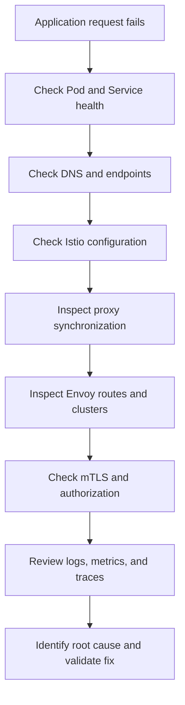

# 13. Istio Operations and Troubleshooting

Learn how to monitor, inspect, diagnose, and troubleshoot Istio service mesh deployments in Kubernetes. This module focuses on practical commands and real-world scenarios that DevOps and SRE engineers encounter while operating Istio in production.

## Table of Contents

- [Learning Objectives](#learning-objectives)
- [1. Istio Operational Overview](#1-istio-operational-overview)
- [2. Essential Troubleshooting Commands](#2-essential-troubleshooting-commands)
- [3. Troubleshooting Sidecar Injection](#3-troubleshooting-sidecar-injection)
- [4. Troubleshooting Envoy and Istiod](#4-troubleshooting-envoy-and-istiod)
- [5. Troubleshooting Service Connectivity](#5-troubleshooting-service-connectivity)
- [6. Troubleshooting Traffic Management](#6-troubleshooting-traffic-management)
- [7. Troubleshooting mTLS and Authorization](#7-troubleshooting-mtls-and-authorization)
- [8. Troubleshooting Gateways](#8-troubleshooting-gateways)
- [9. Logs, Metrics, and Tracing](#9-logs-metrics-and-tracing)
- [10. Performance and Resource Troubleshooting](#10-performance-and-resource-troubleshooting)
- [11. Collecting Diagnostic Information](#11-collecting-diagnostic-information)
- [12. Hands-On Troubleshooting Labs](#12-hands-on-troubleshooting-labs)
- [13. Production Best Practices](#13-production-best-practices)
- [14. Interview Questions](#14-interview-questions)
- [Official Resources](#official-resources)
- [Next Module](#next-module)

## Learning Objectives

By the end of this module, you should be able to:

- Diagnose common Istio configuration problems.
- Inspect Envoy proxy configuration and synchronization.
- Troubleshoot sidecar injection and service connectivity.
- Identify traffic routing, mTLS, and authorization failures.
- Investigate ingress gateway problems.
- Use logs, metrics, and traces to identify application issues.
- Collect useful diagnostic information without unnecessarily disrupting workloads.

## 1. Istio Operational Overview

Istio consists of a control plane and a data plane.

- **Istiod:** Manages service discovery, configuration distribution, and workload identity.
- **Envoy proxies:** Enforce traffic policies and provide telemetry for participating workloads in sidecar mode.
- **Ingress and egress gateways:** Manage configured entry and exit traffic.
- **Observability stack:** Tools such as Prometheus, Grafana, Kiali, and Jaeger can help investigate mesh behavior when configured.

### Troubleshooting flow



**Golden rule:** Start with the simplest checks first. Verify that the application is healthy before assuming that Istio is responsible.

## 2. Essential Troubleshooting Commands

### Kubernetes commands

```bash
# Check workloads
kubectl get pods -A
kubectl get deployments -A

# Inspect a Pod
kubectl describe pod <pod-name> -n <namespace>

# View application logs
kubectl logs <pod-name> -n <namespace> -c <container-name>

# View previous container logs
kubectl logs <pod-name> -n <namespace> \
  -c <container-name> --previous

# Check Services and endpoints
kubectl get svc,endpointslice -n <namespace>

# Inspect recent events
kubectl get events -n <namespace> \
  --sort-by=.lastTimestamp
```

### Istio commands

```bash
# Check Istio installation and version
istioctl version

# Analyze configuration issues
istioctl analyze --all-namespaces

# Inspect proxy synchronization
istioctl proxy-status

# Describe the Istio configuration associated with a Pod
istioctl x describe pod <pod-name> -n <namespace>

# Inspect Envoy configuration
istioctl proxy-config all <pod-name> -n <namespace>

# Inspect Envoy listeners, routes, clusters, and endpoints
istioctl proxy-config listeners <pod-name> -n <namespace>
istioctl proxy-config routes <pod-name> -n <namespace>
istioctl proxy-config clusters <pod-name> -n <namespace>
istioctl proxy-config endpoints <pod-name> -n <namespace>
```

Use an `istioctl` version compatible with your installed control plane. These commands primarily target sidecar-based workloads; ambient mesh has different data-plane diagnostics.

References: [Istioctl Analyze](https://istio.io/latest/docs/ops/diagnostic-tools/istioctl-analyze/) and [Debugging Envoy and Istiod](https://istio.io/latest/docs/ops/diagnostic-tools/proxy-cmd/).

## 3. Troubleshooting Sidecar Injection

### Problem

An application Pod runs, but the expected `istio-proxy` container is missing.

### Step 1: Check the namespace label

```bash
kubectl get namespace <namespace> --show-labels
```

For automatic sidecar injection, the namespace commonly uses:

```bash
kubectl label namespace <namespace> istio-injection=enabled
```

Check the injection configuration and webhook health if the label is correct.

### Step 2: Inspect the Pod containers

```bash
kubectl get pod <pod-name> -n <namespace> \
  -o jsonpath='{.spec.containers[*].name}'
```

For a sidecar-injected Pod, the output should include `istio-proxy`.

### Step 3: Recreate the Pod

Injection occurs when Pods are created. Changing the namespace label does not automatically inject a sidecar into an existing Pod.

For a Deployment:

```bash
kubectl rollout restart deployment/<deployment-name> \
  -n <namespace>

kubectl rollout status deployment/<deployment-name> \
  -n <namespace>
```

### Other things to check

- Is the Istio injection webhook healthy?
- Is the workload explicitly configured to skip injection?
- Is the correct injection revision selected?
- Are there admission webhook errors in Pod events?
- Is the workload using ambient mode instead of sidecar mode?

## 4. Troubleshooting Envoy and Istiod

### Understanding `istioctl proxy-status`

```bash
istioctl proxy-status
```

This command shows the connection and configuration synchronization state of Envoy proxies relative to Istiod.

Common states include:

| State | Meaning |
|---|---|
| SYNCED | The proxy has acknowledged the relevant configuration |
| STALE | The proxy has not acknowledged the latest configuration |
| NOT SENT | The relevant configuration has not been sent |
| Missing proxy | The proxy may not be connected to the control plane or may not be represented in the output |

Exact output and columns vary by Istio version.

### Inspect proxy configuration

```bash
istioctl proxy-config listeners <pod-name> -n <namespace>
istioctl proxy-config routes <pod-name> -n <namespace>
istioctl proxy-config clusters <pod-name> -n <namespace>
istioctl proxy-config endpoints <pod-name> -n <namespace>
```

Use these commands to answer specific questions:

- Is the expected listener present?
- Does the proxy have the expected route?
- Does the destination cluster exist?
- Are healthy endpoints configured for the destination?

### Check Istiod logs

```bash
kubectl get pods -n istio-system

kubectl logs -n istio-system \
  deployment/istiod --since=15m
```

If the deployment has multiple replicas or a different name, identify the correct Pod and inspect its logs.

### Common causes of synchronization issues

- Network connectivity problems between proxies and Istiod.
- Incorrect or invalid mesh configuration.
- Resource pressure on the control plane.
- Version incompatibilities or installation issues.
- Proxies that are disconnected or restarting repeatedly.

## 5. Troubleshooting Service Connectivity

### Scenario: Frontend cannot reach backend

Check the following in order.

**Step 1 — Verify Pod health**

```bash
kubectl get pods -n <namespace> -o wide
kubectl describe pod <backend-pod> -n <namespace>
```

**Step 2 — Verify the Service**

```bash
kubectl get svc backend -n <namespace>
kubectl describe svc backend -n <namespace>
```

Confirm that the Service selector matches the backend Pod labels and that its port and `targetPort` are correct.

**Step 3 — Verify endpoints**

```bash
kubectl get endpointslice -n <namespace> \
  -l kubernetes.io/service-name=backend
```

If no usable endpoints exist, investigate Pod labels, readiness, and Service selectors.

**Step 4 — Test DNS and HTTP from the client**

```bash
kubectl exec -n <namespace> <frontend-pod> \
  -c <client-container> -- \
  curl -v http://backend.<namespace>.svc.cluster.local:<port>/
```

Replace `<port>` with the Service port and use a client container that has `curl` installed.

**Step 5 — Inspect Envoy endpoints**

```bash
istioctl proxy-config endpoints <frontend-pod> \
  -n <namespace>
```

Check whether the destination has endpoints and whether the expected destination cluster is present.

### Common causes

- Incorrect Service selectors or port mappings.
- DNS resolution failures.
- Unready or crashing backend Pods.
- Missing or incorrect `VirtualService` or `DestinationRule` configuration.
- mTLS incompatibility.
- An `AuthorizationPolicy` denying the request.
- Kubernetes NetworkPolicy or CNI-level connectivity restrictions.

## 6. Troubleshooting Traffic Management

Istio traffic management uses resources such as `VirtualService` and `DestinationRule`.

### Problem: Requests are routed to the wrong version

Inspect the resources:

```bash
kubectl get virtualservice,destinationrule -n <namespace>
kubectl get pods -n <namespace> --show-labels
```

Check:

1. The `VirtualService` host matches the intended Service.
2. The destination subset name matches a subset in the `DestinationRule`.
3. Subset labels match the actual Pod labels.
4. The route weights and match conditions are correct.
5. The Envoy proxy has received the updated configuration.

### Inspect Envoy routes

```bash
istioctl proxy-config routes <pod-name> -n <namespace>
```

If a route is missing or unexpected, run:

```bash
istioctl analyze -n <namespace>
istioctl x describe pod <pod-name> -n <namespace>
```

### Problem: Requests return HTTP 503

An HTTP 503 from an Istio-managed request can have several causes. Do not assume every 503 is an Istio failure.

Investigate:

- Whether backend endpoints are healthy.
- Whether the route points to a valid destination.
- Whether a connection pool or outlier-detection policy is affecting traffic.
- Whether mTLS or authorization is preventing communication.
- Whether Envoy reports an upstream connection failure or no healthy upstream.

Inspect proxy logs and configuration before changing policies.

## 7. Troubleshooting mTLS and Authorization

### Problem: Service requests fail after enabling strict mTLS

Check the peer authentication policy:

```bash
kubectl get peerauthentication -A
```

Inspect destination-side and client-side policies, workload identity, and proxy configuration.

A strict mTLS policy requires participating connections to use the expected mutual TLS configuration. Workloads or clients that do not participate in the mesh may be unable to connect unless the architecture and policies explicitly support them.

### Problem: Requests return HTTP 403

Check authorization policies:

```bash
kubectl get authorizationpolicy -A
kubectl describe authorizationpolicy -n <namespace>
```

Review:

- The target workload selector.
- The source principal or namespace.
- The requested HTTP method and path.
- Whether an `ALLOW` policy exists and whether it matches the request.
- Whether a `DENY` policy applies.

### Problem: JWT authentication fails

Inspect the applicable request authentication policy:

```bash
kubectl get requestauthentication -A
kubectl describe requestauthentication -n <namespace>
```

Validate the token issuer, signing keys, audience where configured, token expiration, and the request's authorization requirements.

**Important distinction:** `RequestAuthentication` validates JWTs when they are supplied, but does not by itself require every request to include a valid JWT. Use an appropriate `AuthorizationPolicy` when requests without a valid identity must be denied.

Avoid weakening security policies as a first troubleshooting step. Identify the failing policy and correct the intended identity or rule.

## 8. Troubleshooting Gateways

Ingress gateways handle configured traffic entering the mesh. Egress gateways can be used to control configured outbound traffic.

### Step 1: Check gateway workloads

```bash
kubectl get pods,svc -n istio-system
```

Confirm that the gateway Pod is healthy and its Service exposes the expected ports.

### Step 2: Inspect gateway configuration

```bash
kubectl get gateway,virtualservice -A
kubectl describe gateway <gateway-name> -n <namespace>
kubectl describe virtualservice <virtualservice-name> -n <namespace>
```

For Kubernetes Gateway API deployments:

```bash
kubectl get gatewayclass,gateway -A
kubectl get httproute -A
```

### Step 3: Verify routing

Check:

- Gateway selector or Gateway API controller association.
- Listener port and protocol.
- Hostname matching.
- TLS certificate and Secret configuration when HTTPS is used.
- VirtualService gateway references or HTTPRoute attachment.
- Backend Service ports and endpoints.

### Step 4: Test with the correct hostname

When testing a local port-forward or load balancer, send the expected `Host` header if the route uses hostname-based matching.

```bash
curl -v -H 'Host: app.example.com' \
  http://127.0.0.1:<local-port>/
```

For HTTPS, test with the appropriate hostname and certificate configuration rather than assuming an HTTP test validates TLS.

## 9. Logs, Metrics, and Tracing

Use telemetry to understand whether failures are isolated to one workload or affect the entire mesh.

### Application and proxy logs

```bash
kubectl logs <pod-name> -n <namespace> \
  -c <application-container> --since=15m

kubectl logs <pod-name> -n <namespace> \
  -c istio-proxy --since=15m
```

Compare timestamps between application and proxy logs. Check HTTP status codes, upstream failures, retries, and connection errors.

### Metrics

When Prometheus is configured, useful Envoy and Istio metrics can include:

- Request totals.
- Request duration.
- Request and response sizes.
- HTTP response codes.
- Upstream connection failures.
- Control-plane health and resource utilization.

Metric names and labels vary by Istio version and telemetry configuration. Use the metrics available in your environment rather than assuming every metric is enabled.

### Distributed tracing

With tracing configured, use your tracing backend to investigate:

- End-to-end request latency.
- Slow downstream services.
- Repeated calls or retries.
- Where a request fails across service boundaries.

Tracing requires appropriate instrumentation and trace-context propagation by applications. Missing spans do not necessarily mean that Istio traffic is failing.

### Useful observability tools

- [Prometheus](https://prometheus.io/)
- [Grafana](https://grafana.com/)
- [Kiali](https://kiali.io/)
- [Jaeger](https://www.jaegertracing.io/)

These tools require installation and configuration; they are not all automatically available in every Istio installation.

## 10. Performance and Resource Troubleshooting

### Check resource usage

```bash
kubectl top pods -A
kubectl top nodes
kubectl describe pod <pod-name> -n <namespace>
```

Look for:

- CPU throttling or high CPU usage.
- Memory pressure and `OOMKilled` containers.
- Frequent restarts.
- Excessive latency or request retries.
- High proxy connection counts.
- Resource pressure on Istiod or gateway workloads.

### Inspect proxy resources

```bash
kubectl get pod <pod-name> -n <namespace> \
  -o jsonpath='{.spec.containers[*].name}'

kubectl describe pod <pod-name> -n <namespace>
```

In sidecar mode, evaluate application and Envoy resources together. Increasing limits without understanding the bottleneck may not resolve the root cause.

### Increase Envoy logging temporarily

For targeted diagnosis, use the supported `istioctl proxy-config log` command:

```bash
istioctl proxy-config log <pod-name> \
  -n <namespace> --level http:debug
```

After reproducing the issue, restore the normal logging level:

```bash
istioctl proxy-config log <pod-name> \
  -n <namespace> --reset
```

Use debug logging only for a limited period. It can produce large volumes of logs and add operational overhead.

## 11. Collecting Diagnostic Information

Before escalating an incident, collect enough evidence for another engineer to reproduce and understand the problem.

### Basic collection checklist

```bash
# Istio version and proxy status
istioctl version
istioctl proxy-status

# Configuration analysis
istioctl analyze --all-namespaces

# Workload status
kubectl get pods -A -o wide
kubectl get svc -A

# Recent events
kubectl get events -A --sort-by=.lastTimestamp

# Control-plane logs
kubectl logs -n istio-system deployment/istiod \
  --since=30m
```

### Generate an Istio bug report

```bash
istioctl bug-report
```

Review the command's help for available filters and options in your installed version. Bug reports may include sensitive operational information, so inspect and sanitize the output before sharing it outside your organization.

### Incident notes

For each issue, record:

- What failed and when it started.
- Which namespaces and workloads are affected.
- Whether the failure is consistent or intermittent.
- Recent deployments or policy changes.
- Relevant error messages and HTTP status codes.
- Commands executed and their outputs.
- The corrective action and its verification.

## 12. Hands-On Troubleshooting Labs

Use a non-production Kubernetes cluster with Istio installed.

- [ ] **Lab 1 — Missing Sidecar:** Disable injection for a test namespace, create a workload, and identify why `istio-proxy` is absent.
- [ ] **Lab 2 — Service Selector Error:** Change a backend Pod label so that the Service has no matching endpoints. Diagnose and fix it.
- [ ] **Lab 3 — Invalid Subset:** Create a `DestinationRule` subset whose labels do not match any Pod. Use `istioctl analyze` and proxy inspection to diagnose it.
- [ ] **Lab 4 — Traffic Routing Error:** Configure an incorrect `VirtualService` destination and verify the actual Envoy route.
- [ ] **Lab 5 — mTLS Failure:** In an isolated lab, test incompatible client and server TLS expectations and inspect the relevant policy and proxy configuration.
- [ ] **Lab 6 — Authorization Denial:** Add an `AuthorizationPolicy` that denies a test request, identify the rule, and correct it.
- [ ] **Lab 7 — Gateway Hostname Error:** Configure a hostname mismatch and investigate why the request does not reach the backend.
- [ ] **Lab 8 — High Latency:** Introduce a controlled delay in a test application and use logs, metrics, or tracing to locate it.
- [ ] **Lab 9 — Proxy Synchronization:** Inspect `istioctl proxy-status` and investigate a test proxy that is disconnected or not synchronized.
- [ ] **Lab 10 — Incident Report:** Collect diagnostics for a deliberately broken test workload and write a short root-cause report.

For failure-injection labs, isolate the test namespace, avoid production workloads, and restore the original configuration when finished.

## 13. Production Best Practices

1. **Follow a repeatable workflow:** Start with Kubernetes health, then connectivity, Istio configuration, proxy state, and telemetry.
2. **Use compatible versions:** Keep `istioctl` aligned with the installed control-plane version.
3. **Validate before applying:** Run `istioctl analyze` and review manifest changes.
4. **Monitor the control plane:** Track Istiod health, resource usage, and proxy synchronization.
5. **Avoid permanent debug logging:** Enable detailed logs only when needed.
6. **Protect diagnostic data:** Logs, configuration dumps, and bug reports may contain internal hostnames, identity information, or other sensitive details.
7. **Use controlled rollouts:** Test changes in staging and monitor their effects before production rollout.
8. **Keep a rollback path:** Know which manifest or configuration change to revert.
9. **Separate symptoms from root causes:** A 503, for example, may come from an unhealthy backend, a route mismatch, or an upstream connection failure.
10. **Document incident findings:** Turn repeated troubleshooting steps into runbooks and automated checks.

## 14. Interview Questions

1. What is the difference between `istioctl analyze` and `istioctl proxy-status`?
2. How do you verify whether an Envoy proxy has received the latest configuration?
3. How would you troubleshoot a missing sidecar?
4. What does `istioctl proxy-config endpoints` show?
5. What could cause an HTTP 503 in an Istio mesh?
6. How would you troubleshoot a backend Service with no endpoints?
7. What could cause an HTTP 403 response in Istio?
8. How do you diagnose strict mTLS connectivity problems?
9. How would you troubleshoot an ingress gateway that receives traffic but does not route it to a backend?
10. How can Envoy debug logs help diagnose upstream failures?
11. What should you check when Istiod resource usage increases significantly?
12. Why should you avoid leaving Envoy debug logging enabled in production?
13. How do metrics and distributed tracing complement application and proxy logs?
14. What information should be included in an Istio incident report?

## Official Resources

- [Istio Troubleshooting Overview](https://istio.io/latest/docs/ops/diagnostic-tools/)
- [Istioctl Analyze](https://istio.io/latest/docs/ops/diagnostic-tools/istioctl-analyze/)
- [Debugging Envoy and Istiod](https://istio.io/latest/docs/ops/diagnostic-tools/proxy-cmd/)
- [Istioctl Reference](https://istio.io/latest/docs/reference/commands/istioctl/)
- [Istio Security Troubleshooting](https://istio.io/latest/docs/ops/common-problems/security-issues/)
- [Istio Traffic Management](https://istio.io/latest/docs/concepts/traffic-management/)

## Next Module

**[14. Advanced Istio Architecture →](../14-advanced-architecture/README.md)**

Explore advanced architecture concepts, scaling considerations, multi-cluster deployments, and design decisions for operating Istio in larger environments.
