# 14. Advanced Istio Architecture

Explore advanced Istio architecture concepts, scalability, multi-cluster networking, control-plane deployment models, workload identity, and production design considerations.

This module builds on Istio fundamentals, traffic management, security, observability, and troubleshooting to help you understand how Istio operates in large Kubernetes environments.

## Table of Contents

- [Learning Objectives](#learning-objectives)
- [1. Istio Architecture Recap](#1-istio-architecture-recap)
- [2. Control Plane Architecture](#2-control-plane-architecture)
- [3. xDS and Envoy Communication](#3-xds-and-envoy-communication)
- [4. Sidecar vs Ambient Architecture](#4-sidecar-vs-ambient-architecture)
- [5. Single-Cluster and Multi-Cluster Mesh](#5-single-cluster-and-multi-cluster-mesh)
- [6. Multi-Primary and Primary-Remote Models](#6-multi-primary-and-primary-remote-models)
- [7. East-West Traffic and Cross-Cluster Communication](#7-east-west-traffic-and-cross-cluster-communication)
- [8. Multi-Network and Multi-Cluster Design](#8-multi-network-and-multi-cluster-design)
- [9. Scalability and Performance](#9-scalability-and-performance)
- [10. High Availability and Failure Domains](#10-high-availability-and-failure-domains)
- [11. Configuration and Resource Management](#11-configuration-and-resource-management)
- [12. Production Architecture Design](#12-production-architecture-design)
- [13. Hands-On Labs](#13-hands-on-labs)
- [14. Interview Questions](#14-interview-questions)
- [Official Resources](#official-resources)
- [Next Module](#next-module)

## Learning Objectives

By the end of this module, you should be able to:

- Explain Istio's control plane and data plane in depth.
- Understand xDS configuration delivery between Istiod and Envoy.
- Compare sidecar and ambient data-plane architectures.
- Explain multi-cluster deployment models.
- Understand cross-cluster service discovery and traffic routing.
- Identify scalability bottlenecks and failure domains.
- Design a resilient Istio architecture for production workloads.

## 1. Istio Architecture Recap

Istio extends Kubernetes networking with service-to-service security, traffic management, and telemetry.

Its main architectural components are:

- **Istiod:** Manages service discovery, configuration distribution, and workload identity and certificates.
- **Envoy:** A proxy that handles configured application traffic in the sidecar data plane.
- **Ingress gateway:** Handles configured traffic entering the mesh.
- **Egress gateway:** Provides a controlled exit point for selected outbound traffic.
- **Telemetry integrations:** Export metrics, logs, and traces to configured observability systems.

### High-level architecture

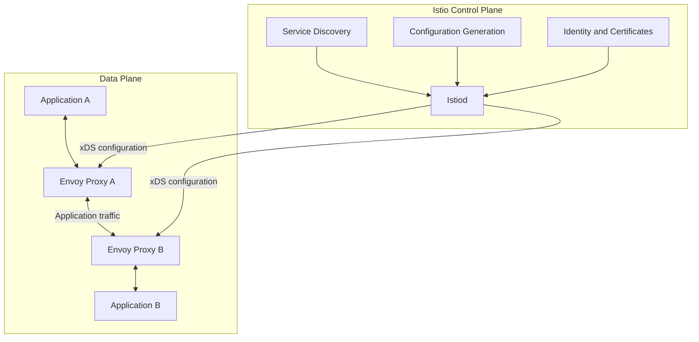

The control plane configures proxies, while proxies handle the application traffic in the data plane. Application traffic does not ordinarily pass through Istiod.

## 2. Control Plane Architecture

### Istiod responsibilities

Istiod combines several major responsibilities:

1. **Service discovery:** Consumes service and endpoint information from supported platform sources, including Kubernetes.
2. **Configuration distribution:** Translates mesh configuration into proxy configuration and distributes it to connected proxies.
3. **Certificate management:** Issues and rotates workload certificates through Istio's identity system.
4. **Policy configuration:** Provides configuration used by proxies to enforce supported traffic and security policies.

### Control-plane flow

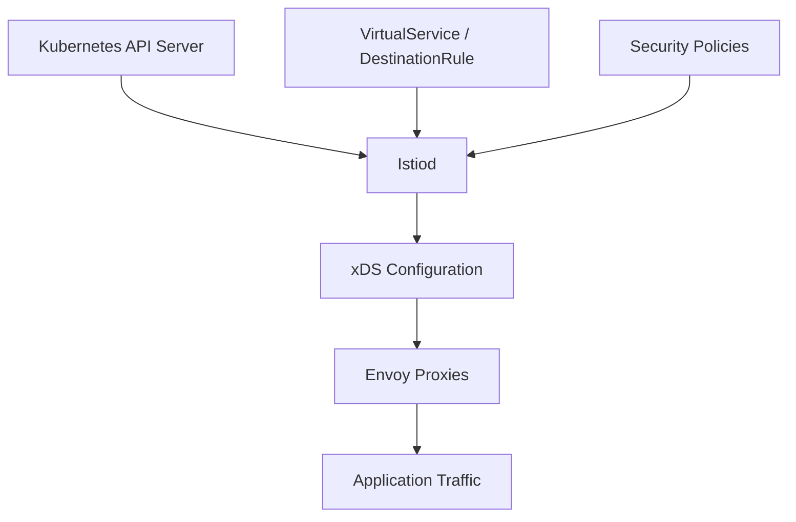

### Important distinction

Istiod does not act as a proxy for every request. It provides configuration and identity-related services; Envoy or the relevant ambient data-plane component enforces the configured behavior.

This separation allows the control plane to manage many proxies without being in the direct application data path.

## 3. xDS and Envoy Communication

**xDS** is a family of APIs Envoy uses to receive configuration dynamically from a management server. In Istio, Istiod acts as the management server for Envoy proxies.

Common xDS resources include:

| API | Purpose                    |
| --- | -------------------------- |
| LDS | Listener Discovery Service |
| RDS | Route Discovery Service    |
| CDS | Cluster Discovery Service  |
| EDS | Endpoint Discovery Service |
| SDS | Secret Discovery Service   |

### How configuration reaches Envoy

1. Istiod observes relevant platform and mesh configuration.
2. Istiod generates the proxy configuration.
3. Envoy connects to Istiod using the supported xDS protocol.
4. Envoy receives configuration updates and acknowledges them.
5. Envoy applies the configuration to handle traffic.

Istio commonly uses xDS over gRPC for this control-plane communication.

### xDS architecture

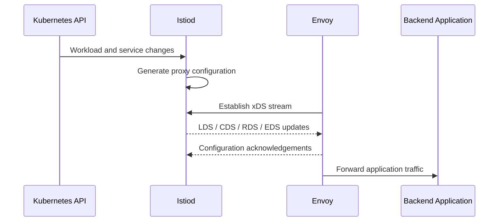

**Important:** xDS configures Envoy; it is not the protocol Envoy uses to communicate with backend applications. Backend communication uses the relevant application or transport protocol, such as HTTP, HTTP/2, gRPC, or TCP.

### Inspect proxy configuration

```bash
istioctl proxy-status

istioctl proxy-config listeners <pod-name> -n <namespace>
istioctl proxy-config routes <pod-name> -n <namespace>
istioctl proxy-config clusters <pod-name> -n <namespace>
istioctl proxy-config endpoints <pod-name> -n <namespace>
```

## 4. Sidecar vs Ambient Architecture

Istio supports different data-plane deployment models.

### Sidecar mode

Each participating application Pod typically contains an Envoy sidecar.

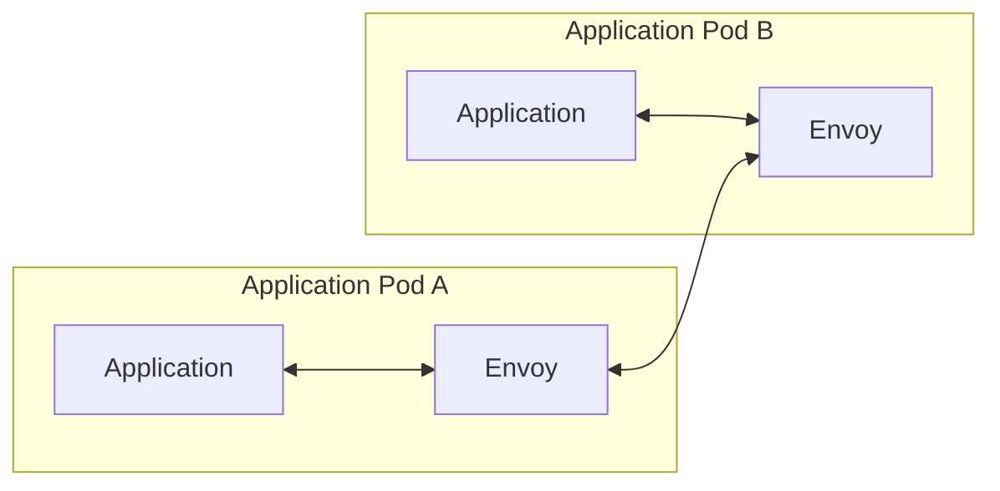

Characteristics:

- Fine-grained per-workload proxy configuration.
- Mature support for traffic management and telemetry features.
- Additional proxy resources per participating Pod.
- Sidecar injection and lifecycle management to consider.

### Ambient mode

Ambient mode uses a sidecarless architecture with node-level `ztunnel` proxies and optional waypoint proxies for supported Layer 7 functionality.

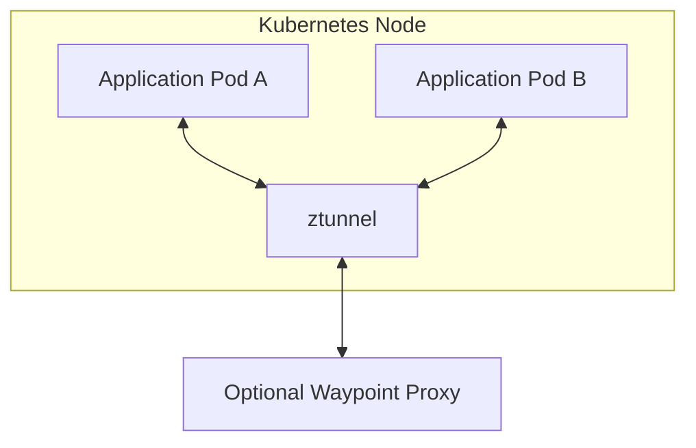

Characteristics:

- Avoids injecting a sidecar into every application Pod.
- Uses ztunnel for core secure connectivity and Layer 4 functionality.
- Uses waypoints for supported Layer 7 traffic management and policy features.
- Has different operational and troubleshooting workflows from sidecar mode.

Feature availability and configuration details vary by Istio release. Confirm support for the features you plan to use before choosing an architecture.

Continue learning in [Module 10 — Ambient Mesh](../10-ambient-mesh/README.md).

## 5. Single-Cluster and Multi-Cluster Mesh

A mesh can span one Kubernetes cluster or multiple clusters.

### Single-cluster architecture

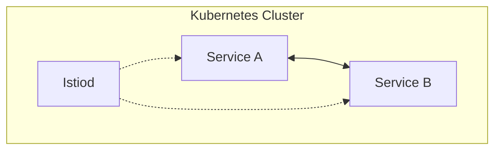

This model is often simpler to deploy and operate because service discovery and networking are concentrated in one cluster.

### Multi-cluster architecture

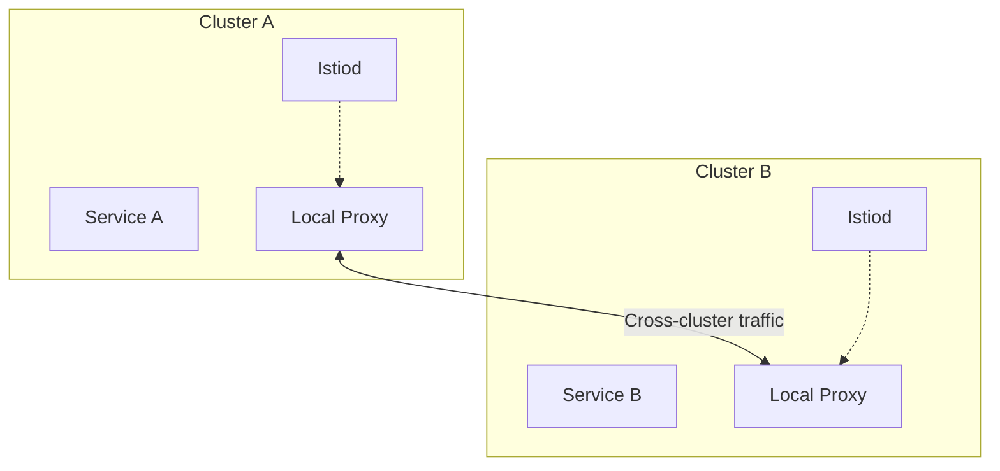

Multi-cluster designs can support:

- Cross-cluster service communication.
- High availability across clusters or zones.
- Workload distribution.
- Regional application deployments.
- Cluster-level isolation and maintenance.

Multi-cluster does not automatically mean a single shared control plane. The control-plane topology depends on the chosen deployment model.

## 6. Multi-Primary and Primary-Remote Models

Two common Istio multi-cluster control-plane models are **multi-primary** and **primary-remote**.

### Multi-primary

Each cluster runs its own Istiod control plane. The control planes discover or exchange the required service information so workloads can communicate across clusters.

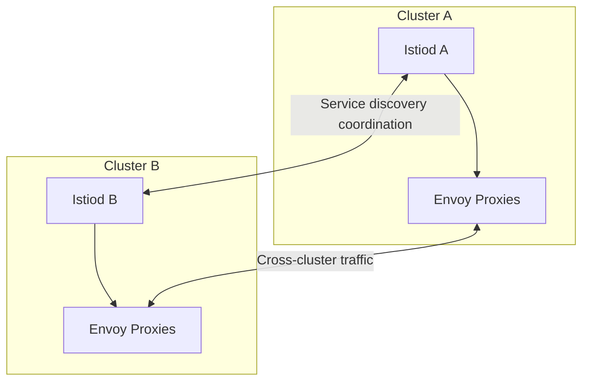

Advantages:

- Control-plane locality.
- Better independence between clusters.
- Potentially improved resilience to a control-plane failure in one cluster.

Trade-offs:

- More control-plane components to operate.
- More complex service discovery and networking setup.
- Cross-cluster trust and configuration must be designed carefully.

### Primary-remote

One cluster hosts the primary control plane, while another cluster runs workloads connected to that control plane.

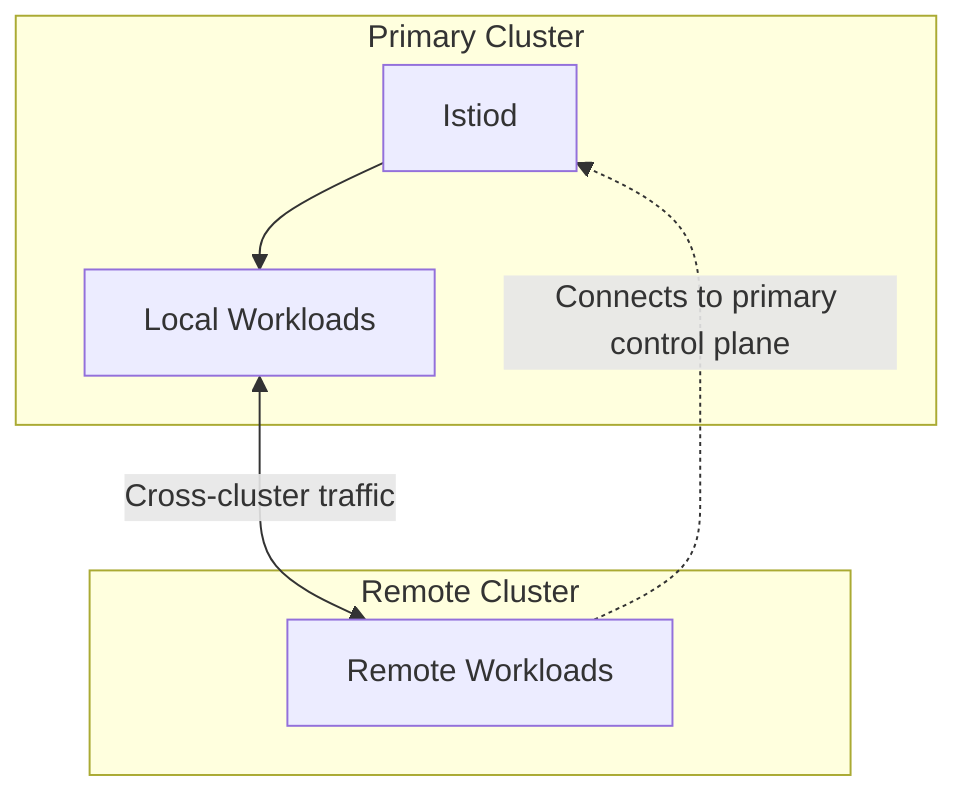

Advantages:

- Centralized control-plane management.
- Potentially fewer control-plane components.

Trade-offs:

- Remote workloads depend on connectivity to the primary control plane for configuration and certificate-related operations.
- The primary control plane becomes an important failure domain.
- Remote cluster networking and trust still require correct configuration.

The diagrams show simplified concepts. Exact topology and connectivity depend on the Istio release, installation method, and network model.

## 7. East-West Traffic and Cross-Cluster Communication

**North-south traffic** typically enters or leaves a cluster or mesh. **East-west traffic** is communication between services, including communication across clusters.

In a multi-network deployment, east-west gateways can provide a controlled path for cross-network traffic.

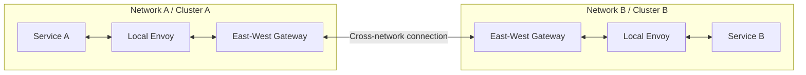

### Key concepts

- **Same network:** Depending on the network topology, workloads may communicate directly using reachable workload addresses.
- **Different networks:** Gateways can provide connectivity when workload addresses are not directly reachable across networks.
- **Service discovery:** The control plane must have the information needed to configure destinations.
- **Security:** Cross-cluster traffic must satisfy the mesh's identity, certificate, and authorization requirements.

### Important considerations

- Configure network connectivity and firewall rules for the required ports.
- Ensure east-west gateway addresses are reachable from other clusters.
- Configure trust and certificate settings correctly.
- Verify that service discovery and endpoint routing work across clusters.
- Do not expose east-west gateways publicly unless the design explicitly requires it and appropriate protections are in place.

Official guide: [Istio Multi-Primary on Different Networks](https://istio.io/latest/docs/setup/install/multicluster/multi-primary_multi-network/).

## 8. Multi-Network and Multi-Cluster Design

A **network** in Istio multi-cluster architecture represents a set of workloads that can communicate directly under the network topology and routing assumptions of the deployment.

A **cluster** is a Kubernetes control and workload environment. Multiple clusters may share a network, or they may be in separate networks.

| Design                               | Main characteristic                                           | Main consideration                           |
| ------------------------------------ | ------------------------------------------------------------- | -------------------------------------------- |
| Single cluster, single network       | One cluster with straightforward connectivity                 | Cluster-level failure domain                 |
| Multiple clusters, shared network    | Clusters have network-level workload reachability             | Routing, overlapping addresses, and security |
| Multiple clusters, multiple networks | Cross-network traffic requires additional connectivity design | Gateways, routing, and firewall rules        |
| Regional multi-cluster               | Workloads distributed across regions                          | Latency, failover, data locality, and cost   |

### Design questions

Before choosing a topology, ask:

1. Do the clusters need direct workload IP reachability?
2. Are the clusters in the same network or separate networks?
3. Should each cluster operate its own control plane?
4. What happens when a region or control plane becomes unavailable?
5. How are certificates, trust domains, and authorization managed?
6. What latency and data-residency requirements apply?
7. How will upgrades be rolled out and rolled back?

## 9. Scalability and Performance

Istio's performance depends on workload count, traffic patterns, configuration complexity, telemetry, and proxy resources.

### Main factors

**Proxy resources**

- CPU and memory consumption.
- Number of active connections.
- Request rate and payload size.
- TLS and protocol overhead.

**Control-plane resources**

- Number of connected proxies.
- Frequency and size of configuration changes.
- Service and endpoint counts.
- Certificate issuance and rotation activity.

**Telemetry**

- Metrics cardinality.
- Log volume.
- Tracing sampling rate.
- Exporter and collector capacity.

### Operational recommendations

- Load-test representative traffic patterns.
- Size proxy resources based on measurements rather than assumptions.
- Monitor Istiod and gateway resource consumption.
- Avoid unnecessarily high-cardinality metrics.
- Tune tracing sampling and log retention.
- Roll out policy and routing changes gradually.
- Evaluate connection pooling and retry behavior to avoid amplifying traffic during failures.

### Example monitoring commands

```bash
kubectl top pods -n istio-system
kubectl top nodes

kubectl get pods -n istio-system
kubectl get hpa -A
```

These commands depend on metrics-server being installed and configured. Use your monitoring stack for longer-term trends and alerting.

## 10. High Availability and Failure Domains

Production architecture should consider failures of workloads, nodes, gateways, control planes, clusters, and regions.

| Failure                 | Possible impact                                                         | Design consideration                                   |
| ----------------------- | ----------------------------------------------------------------------- | ------------------------------------------------------ |
| Application Pod failure | Reduced backend capacity                                                | Replicas, readiness probes, and rollout strategy       |
| Node failure            | Multiple Pods may become unavailable                                    | Replicas and topology spread                           |
| Gateway failure         | Ingress or selected egress traffic disruption                           | Multiple gateway replicas and resilient infrastructure |
| Istiod failure          | Configuration updates and some control-plane operations may be affected | Control-plane availability and recovery                |
| Cluster failure         | Local workloads may become unavailable                                  | Multi-cluster failover and application data strategy   |
| Network partition       | Cross-cluster traffic may fail                                          | Network resilience and failure testing                 |

### Control plane versus data plane

An existing Envoy proxy can often continue using its last accepted configuration during a temporary loss of control-plane connectivity. However, it may not receive new configuration, and certificate rotation or other control-plane-dependent operations may be affected.

Do not assume that every feature will continue indefinitely during an outage. Behavior depends on the configuration, certificate validity, failure duration, and workload topology.

### High-availability checklist

- Run multiple application replicas where appropriate.
- Distribute workloads across nodes and availability zones.
- Deploy gateway replicas across failure domains.
- Monitor control-plane availability and proxy synchronization.
- Define cross-cluster failover behavior.
- Test failure scenarios before production incidents occur.
- Ensure application data stores have their own availability and recovery strategy.

## 11. Configuration and Resource Management

As a mesh grows, configuration governance becomes important.

### Configuration categories

- Traffic routing: `VirtualService`, `DestinationRule`, and gateway resources.
- Security: `PeerAuthentication`, `RequestAuthentication`, and `AuthorizationPolicy`.
- Workload configuration: Kubernetes Deployments, Services, and ServiceAccounts.
- Platform configuration: Istio installation settings and mesh configuration.
- Telemetry: metrics, tracing, and access-log settings.

### Best practices

1. Store declarative configuration in version control.
2. Review security-sensitive changes before deployment.
3. Validate configuration before applying it.
4. Separate environment-specific settings where necessary.
5. Avoid conflicting routing and authorization rules.
6. Track Istio version compatibility during upgrades.
7. Use staged rollouts for control-plane and data-plane changes.
8. Maintain documented rollback procedures.

Useful commands:

```bash
istioctl analyze --all-namespaces
istioctl proxy-status
kubectl get virtualservice,destinationrule -A
kubectl get peerauthentication,authorizationpolicy -A
```

## 12. Production Architecture Design

Consider an e-commerce application running across two Kubernetes clusters in separate availability zones or regions.

Requirements:

- Frontend, order, payment, and inventory services.
- Encrypted service-to-service communication.
- Controlled ingress traffic.
- Observability and alerting.
- Ability to recover from a cluster failure.

### Example architecture

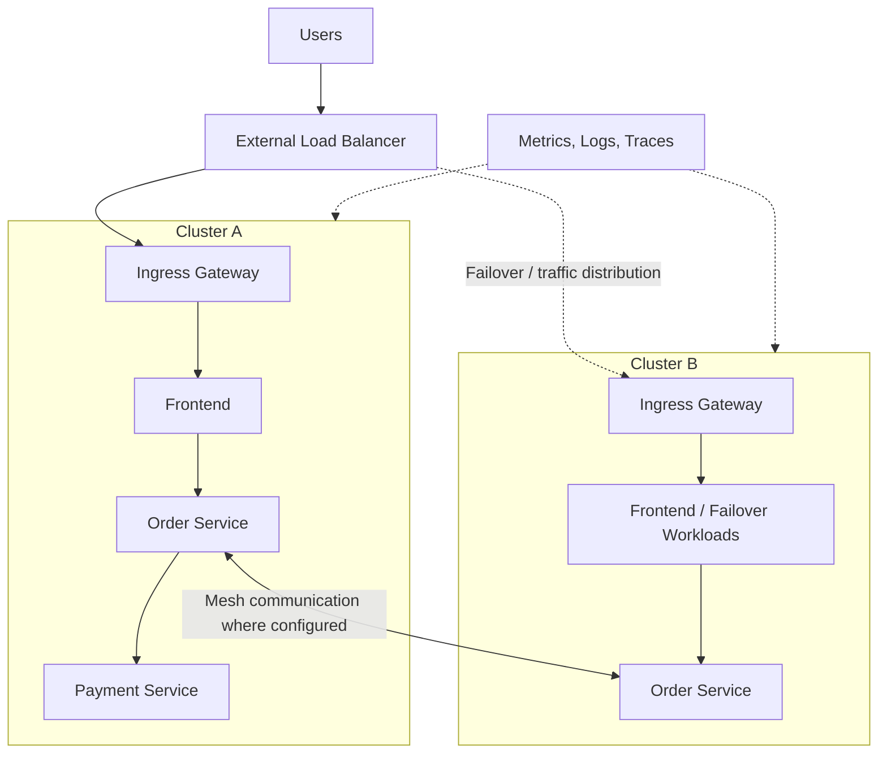

This is a conceptual design, not a complete deployable configuration. The load balancer's health checks and routing policies must be configured to support the intended failover behavior. Cross-cluster service communication requires compatible Istio networking and service discovery configuration.

### Design checklist

**Networking**

- [ ] Decide whether clusters share a network.
- [ ] Define ingress and east-west gateway connectivity.
- [ ] Document firewall and routing requirements.

**Security**

- [ ] Configure workload identity and certificate trust.
- [ ] Define mTLS requirements.
- [ ] Apply least-privilege authorization policies.
- [ ] Protect gateway endpoints and secrets.

**Availability**

- [ ] Define workload replicas and topology spread.
- [ ] Plan gateway and control-plane availability.
- [ ] Decide how traffic fails over between clusters.
- [ ] Test cluster and network failure scenarios.

**Observability**

- [ ] Collect application and proxy metrics.
- [ ] Centralize logs where appropriate.
- [ ] Configure distributed tracing.
- [ ] Alert on request failures, latency, and mesh health.

**Operations**

- [ ] Establish version and upgrade policies.
- [ ] Validate changes before rollout.
- [ ] Define rollback and incident response procedures.

## 13. Hands-On Labs

Complete these labs using a non-production Kubernetes environment.

- [ ] **Lab 1 — Inspect Istiod:** Examine Istiod Pods, logs, resources, and health.
- [ ] **Lab 2 — Explore xDS:** Use `istioctl proxy-status` and `proxy-config` to trace configuration from the control plane to a workload proxy.
- [ ] **Lab 3 — Compare Data Planes:** Deploy a test workload in sidecar mode and compare it with a supported ambient-mode deployment.
- [ ] **Lab 4 — Measure Proxy Overhead:** Generate controlled traffic and observe CPU, memory, and latency.
- [ ] **Lab 5 — Simulate Control-Plane Disruption:** In an isolated environment, observe the behavior of existing workloads when control-plane connectivity is interrupted. Restore connectivity promptly.
- [ ] **Lab 6 — Explore Multi-Cluster Topology:** Create a two-cluster design diagram identifying control planes, workload networks, gateways, and trust relationships.
- [ ] **Lab 7 — Plan Multi-Cluster Failover:** Define health checks, routing behavior, failover criteria, and recovery steps.
- [ ] **Lab 8 — Build a Production Design:** Document a resilient architecture with security, observability, capacity, and recovery requirements.

For multi-cluster labs, use the official installation guide for your Istio release. These labs can require multiple Kubernetes clusters, network access between clusters, cloud load balancers, and additional infrastructure.

## 14. Interview Questions

1. What are the responsibilities of Istiod?
2. What is xDS, and how does Envoy receive configuration from Istiod?
3. Does application traffic pass through Istiod?
4. What is the difference between LDS, RDS, CDS, EDS, and SDS?
5. What are the main differences between sidecar and ambient mesh?
6. What is the difference between a cluster and a network in Istio?
7. What is the difference between multi-primary and primary-remote architectures?
8. Why might an east-west gateway be required?
9. How does Istio discover services across Kubernetes clusters?
10. What happens to existing proxy configuration if Istiod becomes temporarily unavailable?
11. What factors affect Istiod scalability?
12. How can excessive telemetry cardinality affect the monitoring stack?
13. How would you design Istio for high availability across regions?
14. How would you investigate latency between services in different clusters?
15. What considerations are required before upgrading a multi-cluster mesh?

## Official Resources

- [Istio Architecture](https://istio.io/latest/docs/ops/deployment/architecture/)
- [Istio xDS and Proxy Configuration](https://istio.io/latest/docs/ops/diagnostic-tools/proxy-cmd/)
- [Istio Ambient Mesh](https://istio.io/latest/docs/ambient/architecture/)
- [Istio Multi-Cluster Installation](https://istio.io/latest/docs/setup/install/multicluster/)
- [Multi-Primary on Different Networks](https://istio.io/latest/docs/setup/install/multicluster/multi-primary_multi-network/)
- [Primary-Remote Installation](https://istio.io/latest/docs/setup/install/multicluster/primary-remote/)
- [Istio Performance and Scalability](https://istio.io/latest/docs/ops/deployment/performance-and-scalability/)

## Next Module

**[15. Istio on Amazon EKS →](../15-istio-on-eks/README.md)**

Learn how to deploy and operate Istio on Amazon Elastic Kubernetes Service, including AWS networking, load balancers, security, observability, and production deployment considerations.
