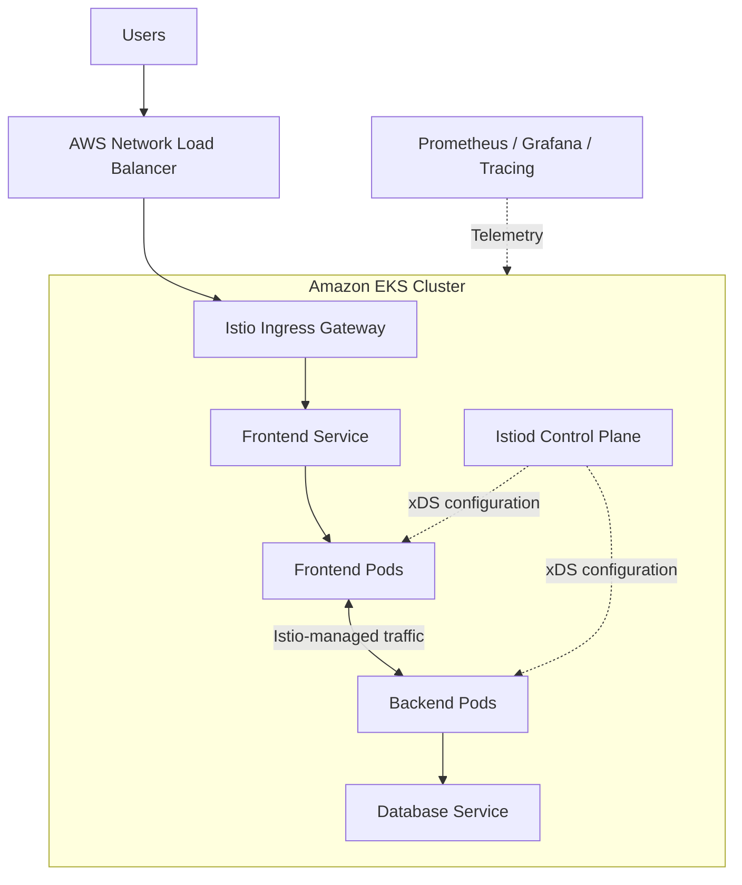
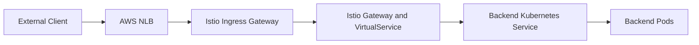

# 15. Istio on Amazon EKS

Learn how to deploy, configure, secure, and operate Istio on Amazon Elastic Kubernetes Service (EKS).

This module combines Kubernetes, AWS networking, and Istio service mesh concepts to build a practical foundation for running microservices on AWS.

## Table of Contents

- [Learning Objectives](#learning-objectives)
- [1. Introduction to Istio on EKS](#1-introduction-to-istio-on-eks)
- [2. Architecture](#2-architecture)
- [3. Prerequisites](#3-prerequisites)
- [4. Create an EKS Cluster](#4-create-an-eks-cluster)
- [5. Install Istio](#5-install-istio)
- [6. Verify the Installation](#6-verify-the-installation)
- [7. Deploy an Application into the Mesh](#7-deploy-an-application-into-the-mesh)
- [8. Expose Istio Ingress Gateway through AWS](#8-expose-istio-ingress-gateway-through-aws)
- [9. Configure Traffic Management](#9-configure-traffic-management)
- [10. Security on EKS](#10-security-on-eks)
- [11. Observability](#11-observability)
- [12. AWS Networking and Load Balancers](#12-aws-networking-and-load-balancers)
- [13. Troubleshooting](#13-troubleshooting)
- [14. Production Best Practices](#14-production-best-practices)
- [15. Hands-On Labs](#15-hands-on-labs)
- [16. Interview Questions](#16-interview-questions)
- [Official Resources](#official-resources)
- [Next Module](#next-module)

## Learning Objectives

By the end of this module, you should be able to:

- Explain how Istio integrates with Amazon EKS.
- Create and connect to an EKS cluster.
- Install Istio using `istioctl`.
- Deploy applications into an Istio mesh.
- Expose applications through an AWS Network Load Balancer (NLB).
- Configure Istio ingress routing and traffic policies.
- Apply mTLS and authorization policies.
- Integrate metrics, logs, and traces.
- Troubleshoot EKS networking and service mesh issues.
- Understand cost, security, and availability considerations.

## 1. Introduction to Istio on EKS

Amazon EKS provides a managed Kubernetes control plane. Istio adds service mesh capabilities to applications running inside the cluster.

**Amazon EKS provides:**
- Managed Kubernetes API server and control plane.
- Integration with AWS VPC networking.
- Worker capacity through managed node groups, Fargate, or supported compute options.
- Integration with AWS IAM and AWS observability and load-balancing services.

**Istio provides:**
- Service-to-service traffic management.
- Mutual TLS (mTLS) and workload identity.
- Routing, retries, timeouts, and traffic shifting.
- Authorization policies.
- Metrics and distributed tracing integrations.

Istio complements Kubernetes and AWS networking; it does not replace them.

## 2. Architecture



### Request flow

1. A user sends a request to the AWS load balancer.
2. The load balancer forwards traffic to the Istio ingress gateway.
3. Istio gateway configuration matches the hostname and route.
4. The gateway forwards traffic to the target Kubernetes Service.
5. Participating workloads use the Istio data plane to enforce configured routing and security policies.
6. Configured telemetry is collected by the monitoring stack.

The load balancer and Istio gateway have separate responsibilities. AWS handles external network distribution, while Istio applies mesh-aware routing and policy.

## 3. Prerequisites

Install the following tools on your workstation:

| Tool | Purpose |
|---|---|
| AWS CLI | Manage AWS resources and credentials |
| `kubectl` | Interact with Kubernetes |
| `eksctl` | Create and manage EKS clusters |
| `istioctl` | Install and troubleshoot Istio |
| Helm | Install Kubernetes packages and controllers |
| Terraform (optional) | Provision infrastructure through code |

Configure your AWS credentials:

```bash
aws configure
aws sts get-caller-identity
```

Verify the installed tools:

```bash
aws --version
kubectl version --client
eksctl version
helm version
```

Install `istioctl` using the official [Istio installation guide](https://istio.io/latest/docs/setup/getting-started/). Use a version compatible with your planned EKS Kubernetes version.

### AWS permissions

You need permission to create and manage the required EKS, EC2, VPC, IAM, and related resources. Creating a cluster and installing load balancer controllers may require additional IAM permissions.

Follow least privilege and avoid using permanent root or administrator credentials for routine operations.

## 4. Create an EKS Cluster

For a learning environment, `eksctl` provides a convenient way to create an EKS cluster.

> **Cost warning:** EKS control-plane charges, worker compute, NAT gateways, load balancers, storage, and data transfer may incur costs. Review the AWS pricing page and delete lab resources when finished.

### Step 1: Create a cluster

Example for a lab environment:

```bash
eksctl create cluster \
  --name istio-eks \
  --region ap-south-1 \
  --nodes 2 \
  --node-type t3.medium
```

Adjust the region and node type for your requirements. Verify current EKS version support, EC2 instance availability, and quotas before creating the cluster.

### Step 2: Verify the cluster

```bash
aws eks list-clusters --region ap-south-1

aws eks update-kubeconfig \
  --name istio-eks \
  --region ap-south-1

kubectl get nodes
kubectl get pods -A
```

### Step 3: Understand the networking

An EKS cluster typically uses a VPC with public and private subnets, depending on the design.

Review:

- VPC CIDR and subnet CIDRs.
- Subnet availability across Availability Zones.
- Route tables and internet or NAT connectivity.
- Security groups and network ACLs.
- VPC CNI and CoreDNS health.
- Whether worker nodes have the required access to pull images and reach AWS APIs.

For production, prefer a deliberate network design rather than relying on default lab settings.

## 5. Install Istio

This module uses the sidecar deployment model for its initial lab.

### Step 1: Download Istio

Follow the official installation guide to select a supported release and install the `istioctl` binary.

Verify:

```bash
istioctl version
```

### Step 2: Install the demo profile

```bash
istioctl install --set profile=demo -y
```

The `demo` profile is useful for learning and demonstrations. It is not a recommended production profile because its configuration prioritizes exploration over production hardening.

### Step 3: Check the control plane

```bash
kubectl get pods -n istio-system
kubectl get svc -n istio-system
```

The `istiod` Pod should become ready. The installation also normally creates an Istio ingress gateway workload and Service, depending on the profile and installation settings.

For production, choose an installation profile and settings appropriate to your workload, resource requirements, and security policies.

## 6. Verify the Installation

Check the Istio version and proxy status:

```bash
istioctl version
istioctl proxy-status
istioctl analyze --all-namespaces
```

Inspect the gateway Service:

```bash
kubectl get svc istio-ingressgateway -n istio-system
```

If the gateway Service is configured as `LoadBalancer`, AWS integration should provision the relevant load balancer when the cluster's load-balancing configuration supports it.

Check the Service's external hostname:

```bash
kubectl get svc istio-ingressgateway -n istio-system \
  -o jsonpath='{.status.loadBalancer.ingress[0].hostname}'
```

The hostname may be empty while provisioning is in progress or if no controller is configured to provision the requested load balancer.

## 7. Deploy an Application into the Mesh

This lab deploys a backend application and a frontend client in a namespace with automatic sidecar injection.

### Step 1: Create a namespace

```bash
kubectl create namespace istio-eks-demo

kubectl label namespace istio-eks-demo \
  istio-injection=enabled
```

### Step 2: Deploy the backend

Create `backend.yaml`:

```yaml
apiVersion: apps/v1
kind: Deployment
metadata:
  name: backend
  namespace: istio-eks-demo
spec:
  replicas: 2
  selector:
    matchLabels:
      app: backend
      version: v1
  template:
    metadata:
      labels:
        app: backend
        version: v1
    spec:
      containers:
        - name: backend
          image: hashicorp/http-echo:1.0.0
          args:
            - "-listen=:5678"
            - "-text=Hello from EKS Istio backend"
          ports:
            - containerPort: 5678
---
apiVersion: v1
kind: Service
metadata:
  name: backend
  namespace: istio-eks-demo
spec:
  selector:
    app: backend
  ports:
    - name: http
      port: 80
      targetPort: 5678
```

Apply it:

```bash
kubectl apply -f backend.yaml
kubectl rollout status deployment/backend -n istio-eks-demo
```

### Step 3: Deploy a frontend client

Create `frontend.yaml`:

```yaml
apiVersion: v1
kind: Pod
metadata:
  name: frontend
  namespace: istio-eks-demo
  labels:
    app: frontend
spec:
  containers:
    - name: curl
      image: curlimages/curl:8.10.1
      command: ["sh", "-c", "sleep 36000"]
```

Apply and verify:

```bash
kubectl apply -f frontend.yaml

kubectl wait --for=condition=Ready pod/frontend \
  -n istio-eks-demo --timeout=120s

kubectl get pods -n istio-eks-demo
```

In sidecar mode, the injected application Pod should normally show both the application container and `istio-proxy`.

### Step 4: Test service communication

```bash
kubectl exec -n istio-eks-demo frontend -c curl -- \
  curl -sS http://backend.istio-eks-demo.svc.cluster.local
```

Expected response:

```text
Hello from EKS Istio backend
```

This verifies that the client can resolve and reach the backend Service. Additional tests are needed to verify specific Istio routing, mTLS, and authorization behavior.

## 8. Expose Istio Ingress Gateway through AWS

A common EKS architecture uses an AWS Network Load Balancer to expose the Istio ingress gateway.

The NLB handles external network traffic distribution, while Istio's gateway and routing resources handle mesh-aware HTTP or TLS routing.

### Architecture



### Step 1: Inspect the ingress gateway Service

```bash
kubectl get svc istio-ingressgateway -n istio-system
```

Check whether the Service type is `LoadBalancer`.

For an existing Service, verify which controller owns it and how it provisions AWS resources. Do not blindly change Service annotations in a production cluster.

### Step 2: Create a Gateway resource

Create `gateway.yaml`:

```yaml
apiVersion: networking.istio.io/v1
kind: Gateway
metadata:
  name: backend-gateway
  namespace: istio-eks-demo
spec:
  selector:
    istio: ingressgateway
  servers:
    - port:
        number: 80
        name: http
        protocol: HTTP
      hosts:
        - backend.example.com
---
apiVersion: networking.istio.io/v1
kind: VirtualService
metadata:
  name: backend-route
  namespace: istio-eks-demo
spec:
  hosts:
    - backend.example.com
  gateways:
    - backend-gateway
  http:
    - route:
        - destination:
            host: backend.istio-eks-demo.svc.cluster.local
            port:
              number: 80
```

Apply the configuration:

```bash
kubectl apply -f gateway.yaml
kubectl get gateway,virtualservice -n istio-eks-demo
```

The gateway selector must match the labels on your actual ingress gateway Pods. The example uses `istio: ingressgateway`, which is common but should be verified in your installation.

### Step 3: Retrieve the AWS load balancer hostname

```bash
export LB_HOST=$(kubectl get svc istio-ingressgateway \
  -n istio-system \
  -o jsonpath='{.status.loadBalancer.ingress[0].hostname}')

echo "$LB_HOST"
```

If the hostname is empty, inspect the Service, events, controller logs, subnet tags, and IAM configuration.

### Step 4: Test the route

```bash
curl -i -H "Host: backend.example.com" "http://${LB_HOST}/"
```

Expected response body:

```text
Hello from EKS Istio backend
```

This test assumes the gateway Service exposes HTTP on port 80 and the AWS load balancer has finished provisioning.

For production, use a registered domain, DNS configuration, and an appropriate TLS setup rather than exposing an application over plain HTTP.

## 9. Configure Traffic Management

Istio supports advanced routing policies on top of Kubernetes Services.

### Weighted traffic routing

For example, route 90% of traffic to backend v1 and 10% to backend v2.

Both versions must exist and have the expected labels, and the `DestinationRule` subsets must match those labels.

Create `traffic-management.yaml`:

```yaml
apiVersion: networking.istio.io/v1
kind: DestinationRule
metadata:
  name: backend
  namespace: istio-eks-demo
spec:
  host: backend.istio-eks-demo.svc.cluster.local
  subsets:
    - name: v1
      labels:
        version: v1
    - name: v2
      labels:
        version: v2
---
apiVersion: networking.istio.io/v1
kind: VirtualService
metadata:
  name: backend-traffic
  namespace: istio-eks-demo
spec:
  hosts:
    - backend.istio-eks-demo.svc.cluster.local
  http:
    - route:
        - destination:
            host: backend.istio-eks-demo.svc.cluster.local
            subset: v1
          weight: 90
        - destination:
            host: backend.istio-eks-demo.svc.cluster.local
            subset: v2
          weight: 10
```

Apply it:

```bash
kubectl apply -f traffic-management.yaml
```

The weighted route above is for in-mesh requests to the backend Service. If you also need weighted routing for external traffic through the ingress gateway, configure the corresponding gateway-bound `VirtualService` with the same subset destinations and appropriate gateway and host references.

Explore more in [Module 05 — Traffic Management](../05-traffic-management/README.md) and [Module 06 — Canary Deployments](../06-canary-deployments/README.md).

## 10. Security on EKS

A secure EKS service mesh combines AWS identity and network controls, Kubernetes RBAC, and Istio workload-level security.

### Mutual TLS

Apply strict mTLS to workloads in the lab namespace:

```yaml
apiVersion: security.istio.io/v1
kind: PeerAuthentication
metadata:
  name: default
  namespace: istio-eks-demo
spec:
  mtls:
    mode: STRICT
```

Save as `peer-authentication.yaml` and apply it:

```bash
kubectl apply -f peer-authentication.yaml
```

Strict mTLS requires clients to use compatible mesh mTLS when connecting to the protected workloads. Test connectivity before extending this policy to production namespaces.

### Authorization policies

Istio authorization policies restrict which workload identities can access a service.

For example, allow requests to backend Pods only from a frontend ServiceAccount:

```yaml
apiVersion: security.istio.io/v1
kind: AuthorizationPolicy
metadata:
  name: backend-allow-frontend
  namespace: istio-eks-demo
spec:
  selector:
    matchLabels:
      app: backend
  action: ALLOW
  rules:
    - from:
        - source:
            principals:
              - cluster.local/ns/istio-eks-demo/sa/default
```

This example uses the `default` ServiceAccount for illustration. For production, create a dedicated ServiceAccount for the frontend and reference its principal instead. Ensure the frontend is the only intended workload using that identity.

### AWS and Kubernetes security considerations

- Use IAM roles for service accounts (IRSA) or EKS Pod Identity when workloads need AWS API access.
- Keep AWS permissions separate from Istio workload authorization.
- Use least-privilege IAM policies and Kubernetes RBAC.
- Restrict inbound traffic through security groups and suitable network controls.
- Store TLS credentials and application secrets securely.
- Keep EKS, Istio, and node components patched.
- Avoid exposing internal mesh gateways publicly unless required.

Istio mTLS does not replace AWS IAM, Kubernetes RBAC, or VPC security controls; they protect different layers.

## 11. Observability

Observability helps identify latency, failures, and unexpected traffic behavior.

Useful tools include:

| Tool | Purpose |
|---|---|
| Prometheus | Metrics collection |
| Grafana | Metrics dashboards |
| Kiali | Mesh topology and traffic insights |
| Jaeger or another supported tracing backend | Distributed tracing |
| CloudWatch | AWS and EKS infrastructure monitoring and logs when configured |

Istio telemetry can expose request metrics, response codes, latency, and proxy information. Application instrumentation and trace-context propagation are also important for end-to-end tracing.

### Verify telemetry configuration

```bash
kubectl get pods -n istio-system
kubectl get svc -n istio-system
istioctl proxy-status
```

Observability add-ons are not automatically installed in every Istio profile. Install only the tools you need, using instructions compatible with your Istio version.

For a production EKS environment, consider how mesh metrics and application logs will be exported, retained, secured, and monitored.

## 12. AWS Networking and Load Balancers

Understanding AWS networking is essential for operating Istio on EKS.

### NLB vs ALB

| Feature | Network Load Balancer (NLB) | Application Load Balancer (ALB) |
|---|---|---|
| Primary layer | Layer 4 | Layer 7 |
| Common protocols | TCP, TLS, UDP where configured | HTTP and HTTPS |
| Common EKS integration | Kubernetes Service of type `LoadBalancer` | Kubernetes Ingress or supported Gateway API configuration |
| Typical use with Istio | Expose an Istio ingress gateway | Route HTTP/HTTPS at the AWS edge or through a supported gateway design |

Choose the load balancer based on the intended traffic flow and where routing should occur. Avoid implementing duplicate routing layers without a clear requirement.

### AWS Load Balancer Controller

The AWS Load Balancer Controller can provision and manage AWS load balancers based on Kubernetes resources.

Before using it, verify:

- The controller is installed or provided by your EKS operating mode.
- The required IAM permissions are configured.
- Subnets are tagged and discoverable.
- Security groups permit the intended traffic.
- The chosen target type is supported by the workload and networking setup.

Official guide: [AWS Load Balancer Controller](https://docs.aws.amazon.com/eks/latest/userguide/aws-load-balancer-controller.html).

### Networking troubleshooting

```bash
kubectl describe svc istio-ingressgateway -n istio-system
kubectl get events -A --sort-by=.lastTimestamp
kubectl get pods -n istio-system -o wide
```

If a load balancer does not provision or cannot reach the gateway, check AWS controller events and logs, subnet selection, IAM permissions, security groups, target health, and Service configuration.

## 13. Troubleshooting

### Problem 1: EKS nodes are not Ready

```bash
kubectl get nodes
kubectl describe node <node-name>
kubectl get pods -A
```

Check node IAM permissions, networking, capacity, bootstrap issues, and the health of core cluster add-ons.

### Problem 2: Istio sidecar is missing

```bash
kubectl get namespace istio-eks-demo --show-labels
kubectl get pods -n istio-eks-demo
kubectl describe pod <pod-name> -n istio-eks-demo
```

Confirm injection is enabled and recreate Pods created before the namespace was labeled.

### Problem 3: Backend returns HTTP 503

```bash
kubectl get svc,endpointslice -n istio-eks-demo
istioctl proxy-status
istioctl proxy-config endpoints <pod-name> -n istio-eks-demo
```

Check backend readiness, Service selectors, Istio routing, and mTLS or authorization policies.

### Problem 4: AWS load balancer is not created

```bash
kubectl describe svc istio-ingressgateway -n istio-system
kubectl get events -A --sort-by=.lastTimestamp
```

Check the configured load-balancer controller, IAM permissions, subnet tags, security groups, and controller logs.

### Problem 5: Ingress hostname resolves but the route fails

Check the gateway workload, `Gateway` and `VirtualService` configuration, hostname matching, Service ports, backend endpoints, and gateway proxy logs.

```bash
kubectl get gateway,virtualservice -A
kubectl logs -n istio-system deployment/istiod --since=15m
istioctl analyze --all-namespaces
```

Use the correct Pod and container when inspecting gateway logs.

## 14. Production Best Practices

1. Use a supported EKS Kubernetes version and a compatible Istio release.
2. Choose production installation settings rather than the demo profile.
3. Design VPC and subnet topology before cluster creation.
4. Keep AWS IAM permissions and Kubernetes permissions least-privileged.
5. Use dedicated workload ServiceAccounts.
6. Apply Istio security policies gradually and test connectivity.
7. Use TLS for external application traffic.
8. Monitor gateway health, proxy synchronization, request failures, and latency.
9. Plan capacity for application Pods, Envoy proxies, Istiod, and gateways.
10. Use staged deployments and maintain rollback procedures.
11. Track AWS load-balancer, NAT gateway, logging, and data-transfer costs.
12. Delete lab resources after completing exercises.

## 15. Hands-On Labs

Complete these labs in a test AWS account.

- [ ] **Lab 1 — EKS Cluster:** Create a cluster with `eksctl`, configure `kubectl`, and verify node readiness.
- [ ] **Lab 2 — Install Istio:** Install Istio and inspect the control-plane and gateway workloads.
- [ ] **Lab 3 — Sidecar Injection:** Enable injection and verify the `istio-proxy` container.
- [ ] **Lab 4 — Microservice Communication:** Deploy frontend and backend applications and test Service DNS.
- [ ] **Lab 5 — AWS Load Balancer:** Expose the Istio ingress gateway and verify target health.
- [ ] **Lab 6 — Ingress Routing:** Configure an Istio Gateway and VirtualService and test hostname-based routing.
- [ ] **Lab 7 — Traffic Shifting:** Deploy two backend versions and perform a weighted rollout.
- [ ] **Lab 8 — mTLS:** Enforce strict mTLS in an isolated namespace and test workload communication.
- [ ] **Lab 9 — Authorization:** Restrict backend access to a dedicated frontend identity.
- [ ] **Lab 10 — Observability:** Inspect proxy status and view request metrics using a configured telemetry stack.
- [ ] **Lab 11 — Troubleshooting:** Diagnose a missing sidecar, an unreachable Service, and a failed ingress route.
- [ ] **Lab 12 — Cost Review:** Identify provisioned AWS resources and estimate the cost of the lab environment.

### Cleanup

Delete the lab namespace:

```bash
kubectl delete namespace istio-eks-demo
```

This removes the namespace's workloads and namespaced resources but leaves Istio and the EKS cluster installed.

When you have finished all exercises, delete the lab cluster if you no longer need it:

```bash
eksctl delete cluster \
  --name istio-eks \
  --region ap-south-1
```

Review the AWS resources afterward to ensure that any separately created resources have also been removed. Deleting a cluster does not necessarily remove every resource you created independently.

## 16. Interview Questions

1. What is Amazon EKS, and why would you run Istio on it?
2. What responsibilities belong to EKS, AWS networking, and Istio?
3. How does an AWS Network Load Balancer expose an Istio ingress gateway?
4. What is the difference between an NLB and an ALB?
5. What happens when a namespace is labeled for Istio sidecar injection?
6. How does traffic flow from an external client to an in-mesh backend?
7. How would you troubleshoot an EKS Service that has no endpoints?
8. What might cause an AWS load balancer to remain in a pending state?
9. How do Istio mTLS and AWS IAM differ?
10. What is the purpose of IRSA or EKS Pod Identity?
11. How do `VirtualService` and `DestinationRule` work together?
12. How would you enforce least-privilege access between microservices?
13. How do you monitor Istio workloads running on EKS?
14. What additional costs can arise when operating Istio on EKS?
15. How would you design a highly available ingress architecture for production?

## Official Resources

- [Amazon EKS Documentation](https://docs.aws.amazon.com/eks/latest/userguide/what-is-eks.html)
- [Getting Started with Istio](https://istio.io/latest/docs/setup/getting-started/)
- [Istio on Amazon EKS — AWS Open Source Blog](https://aws.amazon.com/blogs/opensource/getting-started-with-istio-on-amazon-eks/)
- [AWS Load Balancer Controller](https://docs.aws.amazon.com/eks/latest/userguide/aws-load-balancer-controller.html)
- [EKS Load Balancing Best Practices](https://docs.aws.amazon.com/eks/latest/best-practices/load-balancing.html)
- [EKS Pod Identity](https://docs.aws.amazon.com/eks/latest/userguide/pod-identities.html)
- [Istio Security](https://istio.io/latest/docs/concepts/security/)
- [Istio Traffic Management](https://istio.io/latest/docs/concepts/traffic-management/)

## Next Module

**[16. Istio Security and DevSecOps →](../16-security-devsecops/README.md)**

Explore how to integrate Istio security into DevSecOps practices, including zero-trust communication, policy enforcement, secure ingress, and security validation in CI/CD pipelines.
