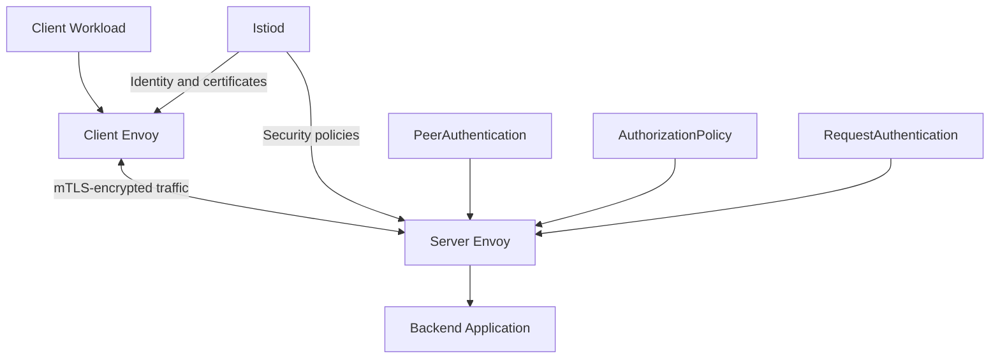

# Module 16: Istio Security & DevSecOps

Learn how to secure Kubernetes workloads with Istio and integrate service-mesh security into a DevSecOps workflow.

## Table of Contents

1. [Learning Objectives](#learning-objectives)
2. [Prerequisites](#prerequisites)
3. [Istio Security Architecture](#istio-security-architecture)
4. [Core Security Concepts](#core-security-concepts)
5. [Lab 1: Enable Strict mTLS](#lab-1-enable-strict-mtls)
6. [Lab 2: Implement Service-to-Service Authorization](#lab-2-implement-service-to-service-authorization)
7. [Lab 3: Configure JWT Authentication](#lab-3-configure-jwt-authentication)
8. [Lab 4: Secure the Ingress Gateway](#lab-4-secure-the-ingress-gateway)
9. [Lab 5: Validate Istio Security Policies](#lab-5-validate-istio-security-policies)
10. [Istio in a DevSecOps Pipeline](#istio-in-a-devsecops-pipeline)
11. [Security Best Practices](#security-best-practices)
12. [Troubleshooting](#troubleshooting)
13. [Interview Questions](#interview-questions)
14. [Official Resources](#official-resources)

---

## Learning Objectives

By completing this module, you will understand how to:

- Implement zero-trust security for microservices.
- Enforce mutual TLS (mTLS) between workloads.
- Control service-to-service access using `AuthorizationPolicy`.
- Validate JWT tokens with `RequestAuthentication`.
- Secure ingress traffic and manage TLS certificates.
- Validate Istio configuration before deployment.
- Integrate manifest, image, dependency, and infrastructure security checks into CI/CD.
- Troubleshoot authentication and authorization failures.

## Prerequisites

- Kubernetes fundamentals: Pods, Deployments, Services, and ServiceAccounts.
- Basic understanding of Istio architecture, Envoy, and traffic management.
- A working Kubernetes cluster.
- Istio installed with sidecar injection enabled for the lab namespace.
- `kubectl` and `istioctl` installed.

Verify your environment:

```bash
kubectl get nodes
istioctl version
kubectl get pods -n istio-system
```

## Istio Security Architecture

Istio applies security controls through the control plane and data plane. Istiod manages configuration and workload identity; Envoy proxies enforce applicable traffic policies in sidecar mode.



The main security layers are:

| Layer | Purpose |
|---|---|
| Workload identity | Identifies services using their mesh identities |
| mTLS | Encrypts traffic and authenticates communicating workloads |
| PeerAuthentication | Defines accepted workload-to-workload transport authentication |
| RequestAuthentication | Validates supported request credentials, such as JWTs |
| AuthorizationPolicy | Controls which identities and requests are allowed |
| Gateway security | Protects external entry points and configures TLS |
| DevSecOps pipeline | Detects security problems before configuration and applications reach production |

## Core Security Concepts

### 1. Mutual TLS (mTLS)

mTLS provides encryption and mutual authentication between participating workloads. Istio can manage workload certificates and rotate them automatically.

PeerAuthentication modes:

- `STRICT`: Accept only mTLS traffic.
- `PERMISSIVE`: Accept mTLS and plaintext traffic.
- `DISABLE`: Disable Istio mTLS for the targeted workload.

Use `STRICT` where workloads and traffic paths have been verified to support mesh mTLS.

### 2. Authentication vs Authorization

| Concept | Question answered | Istio resource |
|---|---|---|
| Peer authentication | Is the connecting workload using the required transport identity? | `PeerAuthentication` |
| Request authentication | Is the presented JWT valid? | `RequestAuthentication` |
| Authorization | Is this identity allowed to perform this operation? | `AuthorizationPolicy` |

**Important:** `RequestAuthentication` validates a JWT when one is supplied, but does not by itself require every request to contain a token. Use an appropriate `AuthorizationPolicy` to require authenticated requests.

### 3. Zero Trust

A zero-trust approach does not automatically trust a workload because it runs inside the cluster. Instead, verify identities, encrypt service communication, and explicitly define allowed access.

---

## Lab 1: Enable Strict mTLS

**Objective:** Require mTLS for workloads in a dedicated namespace.

### Step 1: Create a namespace

```bash
kubectl create namespace istio-devsecops
kubectl label namespace istio-devsecops istio-injection=enabled
```

For an ambient-mode installation, use the ambient enrollment label instead of enabling sidecar injection.

### Step 2: Deploy a backend

Save as `backend.yaml`:

```yaml
apiVersion: v1
kind: ServiceAccount
metadata:
  name: backend-sa
  namespace: istio-devsecops
---
apiVersion: apps/v1
kind: Deployment
metadata:
  name: backend
  namespace: istio-devsecops
spec:
  replicas: 1
  selector:
    matchLabels:
      app: backend
  template:
    metadata:
      labels:
        app: backend
    spec:
      serviceAccountName: backend-sa
      containers:
        - name: backend
          image: hashicorp/http-echo:1.0.0
          args:
            - "-listen=:5678"
            - "-text=Secure backend"
          ports:
            - containerPort: 5678
---
apiVersion: v1
kind: Service
metadata:
  name: backend
  namespace: istio-devsecops
spec:
  selector:
    app: backend
  ports:
    - name: http
      port: 80
      targetPort: 5678
```

Apply the configuration:

```bash
kubectl apply -f backend.yaml
kubectl rollout status deployment/backend -n istio-devsecops
kubectl get pods -n istio-devsecops
```

Verify the backend has an injected `istio-proxy` container.

### Step 3: Enforce strict mTLS

Save as `strict-mtls.yaml`:

```yaml
apiVersion: security.istio.io/v1
kind: PeerAuthentication
metadata:
  name: default
  namespace: istio-devsecops
spec:
  mtls:
    mode: STRICT
```

Apply and verify:

```bash
kubectl apply -f strict-mtls.yaml
kubectl get peerauthentication -n istio-devsecops
```

**Expected result:** Workloads covered by this policy reject connections that do not use the required mTLS transport. A client outside the mesh may fail to connect unless it uses a supported mesh-secured path.

> Do not enable strict mTLS across an existing production mesh without first checking legacy workloads, excluded ports, gateways, and migration requirements.

---

## Lab 2: Implement Service-to-Service Authorization

**Objective:** Allow only an approved workload identity to access the backend.

### Step 1: Create a client ServiceAccount and Pod

Save as `client.yaml`:

```yaml
apiVersion: v1
kind: ServiceAccount
metadata:
  name: frontend-sa
  namespace: istio-devsecops
---
apiVersion: v1
kind: Pod
metadata:
  name: frontend
  namespace: istio-devsecops
  labels:
    app: frontend
spec:
  serviceAccountName: frontend-sa
  containers:
    - name: curl
      image: curlimages/curl:8.10.1
      command: ["/bin/sh", "-c", "sleep 36000"]
```

Apply it:

```bash
kubectl apply -f client.yaml
kubectl wait --for=condition=Ready pod/frontend \
  -n istio-devsecops --timeout=120s
```

Test the backend before adding the authorization policy:

```bash
kubectl exec -n istio-devsecops frontend -c curl -- \
  curl -sS http://backend
```

### Step 2: Allow only the frontend identity

Save as `backend-authorization.yaml`:

```yaml
apiVersion: security.istio.io/v1
kind: AuthorizationPolicy
metadata:
  name: backend-allow-frontend
  namespace: istio-devsecops
spec:
  selector:
    matchLabels:
      app: backend
  action: ALLOW
  rules:
    - from:
        - source:
            principals:
              - cluster.local/ns/istio-devsecops/sa/frontend-sa
```

Apply it:

```bash
kubectl apply -f backend-authorization.yaml
```

Test the approved client:

```bash
kubectl exec -n istio-devsecops frontend -c curl -- \
  curl -i http://backend
```

**Expected result:** The frontend workload is allowed when its traffic presents the matching Istio workload identity.

### Step 3: Verify access denial

Create another client with a different ServiceAccount and test its access to the backend.

```bash
kubectl create serviceaccount unauthorized-sa \
  -n istio-devsecops

kubectl run unauthorized-client \
  -n istio-devsecops \
  --image=curlimages/curl:8.10.1 \
  --overrides='{"spec":{"serviceAccountName":"unauthorized-sa"}}' \
  --command -- sleep 36000
```

Once the Pod is ready, run:

```bash
kubectl exec -n istio-devsecops unauthorized-client -- \
  curl -i --max-time 5 http://backend
```

**Expected result:** The request is denied by the backend's authorization policy. With HTTP traffic through the sidecar, this commonly appears as `403 Forbidden`.

The principal in the policy must match the workload identity used by your cluster. The example assumes the default trust domain, `cluster.local`.

---

## Lab 3: Configure JWT Authentication

**Objective:** Validate JWT tokens and require an authenticated request identity.

`RequestAuthentication` checks tokens presented to the selected workload. `AuthorizationPolicy` makes a valid authenticated identity mandatory.

Save as `jwt-security.yaml` and replace the example issuer and JWKS URL with those from your trusted identity provider.

```yaml
apiVersion: security.istio.io/v1
kind: RequestAuthentication
metadata:
  name: backend-jwt
  namespace: istio-devsecops
spec:
  selector:
    matchLabels:
      app: backend
  jwtRules:
    - issuer: "https://identity.example.com/"
      jwksUri: "https://identity.example.com/.well-known/jwks.json"
---
apiVersion: security.istio.io/v1
kind: AuthorizationPolicy
metadata:
  name: backend-require-jwt
  namespace: istio-devsecops
spec:
  selector:
    matchLabels:
      app: backend
  action: ALLOW
  rules:
    - from:
        - source:
            requestPrincipals:
              - "*"
```

Apply:

```bash
kubectl apply -f jwt-security.yaml
```

Test without a token:

```bash
kubectl exec -n istio-devsecops frontend -c curl -- \
  curl -i http://backend
```

The request should be denied because it has no authenticated request principal.

Test with a valid token issued by the configured provider:

```bash
export JWT_TOKEN="<valid-token-from-your-identity-provider>"

kubectl exec -n istio-devsecops frontend -c curl -- \
  curl -i -H "Authorization: Bearer ${JWT_TOKEN}" http://backend
```

The request should be allowed if the token validates and no other policy blocks it.

**Security notes:**

- Do not commit real tokens, private keys, or credentials to Git.
- Use a trusted issuer and correct JWKS configuration.
- JWT validation is not a substitute for checking roles, claims, scopes, or application-level permissions when those are required.
- The sample policy requires a valid JWT but does not restrict access to particular JWT claims.

---

## Lab 4: Secure the Ingress Gateway

**Objective:** Apply access controls to traffic entering the mesh.

Istio Gateway resources configure listener and TLS behavior. AuthorizationPolicy can restrict who accesses gateway workloads. External HTTPS termination should use an appropriately managed certificate and secret.

### Step 1: Review the ingress gateway

```bash
kubectl get svc -n istio-system
kubectl get pods -n istio-system
```

Identify the gateway workload and its labels before applying any policy.

### Step 2: Restrict ingress access

The following is a policy pattern for allowing only requests with a valid JWT at the ingress gateway. Confirm that the selector matches your actual gateway Pod labels.

```yaml
apiVersion: security.istio.io/v1
kind: RequestAuthentication
metadata:
  name: ingress-jwt
  namespace: istio-system
spec:
  selector:
    matchLabels:
      istio: ingressgateway
  jwtRules:
    - issuer: "https://identity.example.com/"
      jwksUri: "https://identity.example.com/.well-known/jwks.json"
---
apiVersion: security.istio.io/v1
kind: AuthorizationPolicy
metadata:
  name: ingress-require-jwt
  namespace: istio-system
spec:
  selector:
    matchLabels:
      istio: ingressgateway
  action: ALLOW
  rules:
    - from:
        - source:
            requestPrincipals:
              - "*"
```

Before applying this in a shared or production cluster, check existing gateway policies and routes. Because the policy targets gateway workloads, it can affect multiple applications using that gateway.

### Step 3: Configure TLS

For HTTPS ingress, configure a TLS listener in an Istio `Gateway` and reference a certificate credential stored securely in the appropriate namespace.

Review the [Istio Gateway TLS documentation](https://istio.io/latest/docs/tasks/traffic-management/ingress/secure-ingress/).

---

## Lab 5: Validate Istio Security Policies

**Objective:** Detect invalid configuration before rollout.

### Step 1: Analyze the mesh

```bash
istioctl analyze -A
```

Use this to detect configuration issues that Istio can identify. It does not replace runtime testing.

### Step 2: Inspect proxy synchronization

```bash
istioctl proxy-status
```

Inspect the backend's proxy configuration:

```bash
kubectl get pods -n istio-devsecops -l app=backend
istioctl proxy-config listeners <BACKEND_POD> \
  -n istio-devsecops
```

Replace `<BACKEND_POD>` with the actual Pod name.

### Step 3: Perform positive and negative tests

- Approved workload identity can access the backend.
- Unapproved workload identity is denied.
- Missing JWT is denied when the policy requires authentication.
- Invalid JWT is rejected.
- Required mTLS connections succeed.
- Plaintext connections to strict-mTLS workloads fail.

Run these tests in a non-production environment first.

---

## Istio in a DevSecOps Pipeline

Istio security should complement—not replace—security controls in the software delivery pipeline.

```mermaid
flowchart LR
    A["Developer Commit"] --> B["Secret Scanning"]
    B --> C["SAST and Dependency Scanning"]
    C --> D["Container Image Scanning"]
    D --> E["IaC and Kubernetes Manifest Scanning"]
    E --> F["Validate Istio Configuration"]
    F --> G["Deploy to Test Cluster"]
    G --> H["Runtime Security Tests"]
    H --> I["Production Approval"]
    I --> J["Deploy and Monitor"]
```



### Recommended tools

| Security stage | Example tools |
|---|---|
| Secret detection | Gitleaks |
| Static code analysis | SonarQube |
| Dependency vulnerability scanning | OWASP Dependency-Check |
| Container image scanning | Trivy |
| Infrastructure-as-Code scanning | Checkov |
| Kubernetes manifest linting | KubeLinter |
| Kubernetes runtime policy | Kyverno or OPA Gatekeeper |
| Istio configuration validation | `istioctl analyze` |
| Runtime observability | Prometheus, Grafana, Kiali |

Choose tools according to your organization's requirements; installing every tool is not necessary for every pipeline.

### Example GitHub Actions workflow

This example demonstrates basic CI checks for an application repository containing Kubernetes and Istio manifests. It assumes the repository has a `k8s/` directory and a `Dockerfile`. Pin actions and tool versions to approved versions in a production pipeline.

Save as `.github/workflows/security.yml`:

```yaml
name: DevSecOps Security Checks

on:
  pull_request:
  push:
    branches:
      - main

permissions:
  contents: read

jobs:
  security:
    runs-on: ubuntu-latest

    steps:
      - name: Checkout
        uses: actions/checkout@v4

      - name: Scan for secrets
        uses: gitleaks/gitleaks-action@v2

      - name: Scan filesystem and configuration
        uses: aquasecurity/trivy-action@0.28.0
        with:
          scan-type: fs
          scan-ref: .
          scanners: vuln,misconfig,secret
          exit-code: "1"
          severity: HIGH,CRITICAL
```

**Before using this workflow:**

- Pin actions to reviewed commit SHAs according to your organization's supply-chain policy.
- Review the current action documentation and required permissions.
- Add application-specific SAST and dependency scanning.
- Scan container images after building them.
- Validate Kubernetes and Istio YAML using your selected schema/linting tools and `istioctl analyze` in an appropriate environment.
- Use protected branches, required checks, and approvals to control promotion to production.

A CI job that scans files does not automatically validate live Istio behavior. Runtime authorization tests and deployment verification remain necessary.

---

## Security Best Practices

### Workload and traffic security

- Use strict mTLS after verifying workload compatibility.
- Use least-privilege `AuthorizationPolicy` rules.
- Keep workload ServiceAccounts separate when identities need different permissions.
- Require and validate JWTs when external identity is part of the security model.
- Use Kubernetes NetworkPolicies as an additional layer of defense.
- Avoid broad gateway host matching and unnecessary exposed services.

### CI/CD and supply-chain security

- Scan secrets, source code, dependencies, container images, and infrastructure definitions.
- Pin CI actions and container images to approved immutable references where practical.
- Keep credentials out of Git and use workload identity or OIDC for CI cloud access where supported.
- Require security checks and review before production deployment.
- Maintain supported Istio releases and apply security patches promptly.

### Operations

- Test both allowed and denied traffic paths.
- Review proxy and control-plane logs.
- Run `istioctl analyze` during configuration reviews.
- Monitor rejected configurations and unexpected authorization failures.
- Document rollback steps for security policy changes.

For detailed guidance, read the [Istio Security Best Practices](https://istio.io/latest/docs/ops/best-practices/security/).

---

## Troubleshooting

| Problem | Possible cause | Checks |
|---|---|---|
| Requests fail after enabling STRICT mTLS | Client is not using mesh mTLS or workload is not enrolled correctly | `kubectl get pods -n istio-devsecops`; `istioctl proxy-status` |
| HTTP 403 | AuthorizationPolicy denies the request | Check workload selectors, source principal, namespace, and rules |
| JWT request returns 401 | Token is invalid, expired, or issuer/JWKS configuration is incorrect | Check issuer, token claims, and proxy logs |
| JWT-less request still succeeds | RequestAuthentication was configured without a policy requiring an authenticated principal, or another rule permits the request | Review all matching AuthorizationPolicies |
| Policy seems ineffective | Incorrect labels, namespace scope, or stale proxy configuration | `kubectl get authorizationpolicy,peerauthentication,requestauthentication -A`; `istioctl analyze -A` |
| Ingress traffic fails | Gateway host, TLS credential, listener, or route configuration is incorrect | Inspect Gateway, VirtualService, gateway Service, and gateway logs |

Useful commands:

```bash
kubectl get authorizationpolicy,peerauthentication,requestauthentication -A
kubectl logs -n istio-system deploy/istiod
istioctl proxy-status
istioctl analyze -A
```

---

## Cleanup

Remove the lab resources:

```bash
kubectl delete namespace istio-devsecops
```

If you applied the ingress gateway JWT policies, remove them separately after testing:

```bash
kubectl delete requestauthentication ingress-jwt -n istio-system
kubectl delete authorizationpolicy ingress-require-jwt -n istio-system
```

Only delete policies created for this lab. Do not remove shared policies that other applications rely on.

---

## Interview Questions

1. What is zero-trust security in Istio?
2. How does mTLS work between two Istio workloads?
3. What is the difference between `PeerAuthentication` and `RequestAuthentication`?
4. Why is `AuthorizationPolicy` required to make JWT authentication mandatory?
5. What is the difference between authentication and authorization?
6. How do you allow one microservice to access another using its workload identity?
7. What happens when `STRICT` mTLS is enabled for a namespace?
8. How would you troubleshoot an HTTP 403 from an Istio-protected service?
9. How do you secure an Istio ingress gateway?
10. How would you integrate Istio policy validation into GitHub Actions?
11. Does Istio replace Kubernetes NetworkPolicies, application authentication, or a web application firewall?
12. How would you roll out a restrictive security policy without disrupting production?

## Official Resources

- [Istio Security Concepts](https://istio.io/latest/docs/concepts/security/)
- [Istio Security Best Practices](https://istio.io/latest/docs/ops/best-practices/security/)
- [Authentication Policy Tasks](https://istio.io/latest/docs/tasks/security/authentication/authn-policy/)
- [Authorization Policy Tasks](https://istio.io/latest/docs/tasks/security/authorization/)
- [Secure Ingress Gateway with TLS](https://istio.io/latest/docs/tasks/traffic-management/ingress/secure-ingress/)
- [Istio Configuration Analysis](https://istio.io/latest/docs/ops/diagnostic-tools/istioctl-analyze/)

---

## Next Module

➡️ [Module 17: Istio Projects](../17-projects/README.md)

Build practical projects that combine traffic management, zero-trust security, observability, and production troubleshooting.
