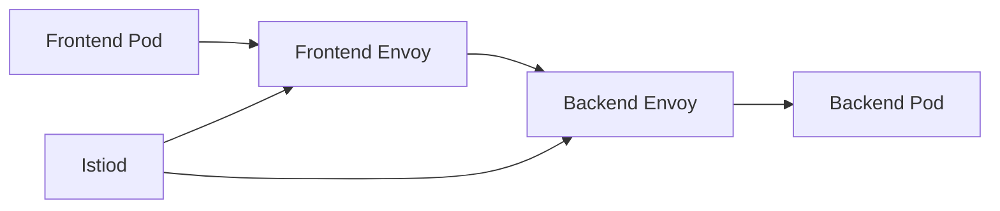
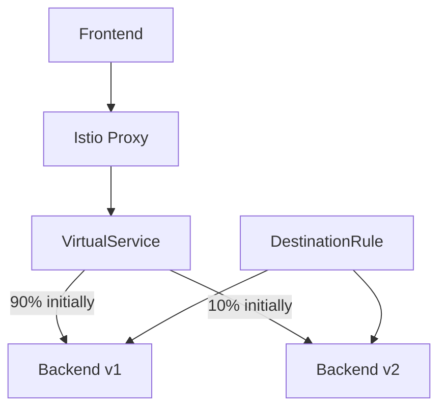
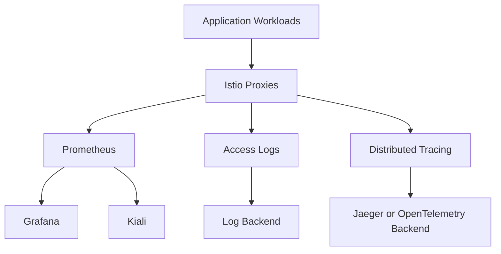
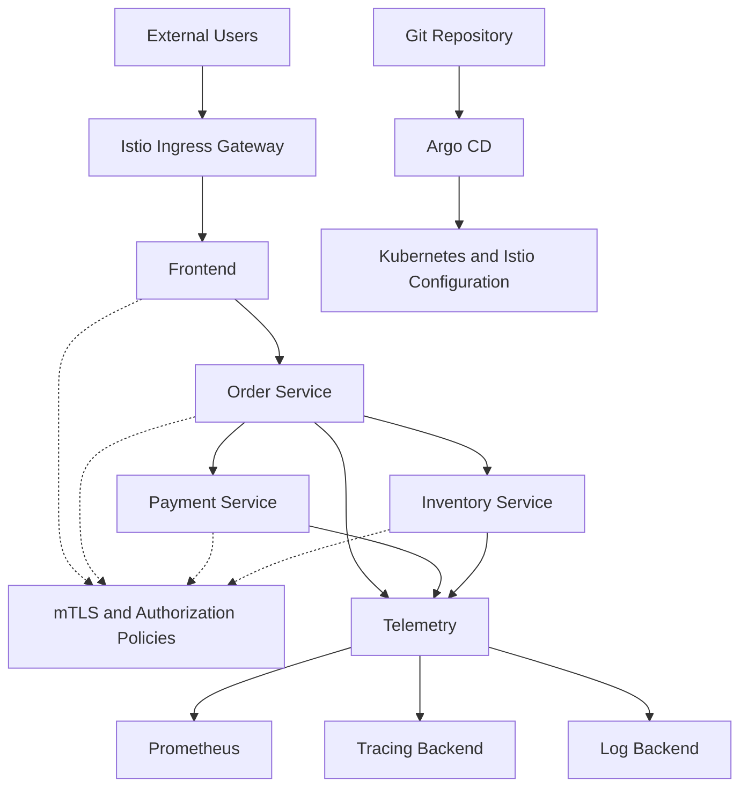

# Module 17: Istio Hands-On Projects

Apply your Istio knowledge through practical projects that simulate real-world DevOps, platform engineering, and production environments.

These projects combine Kubernetes, Istio, traffic management, security, observability, resilience, and AWS EKS.

## Table of Contents

1. [Project Overview](#project-overview)
2. [Prerequisites](#prerequisites)
3. [Project 1: Deploy a Service Mesh](#project-1-deploy-a-service-mesh)
4. [Project 2: Traffic Management and Canary Deployment](#project-2-traffic-management-and-canary-deployment)
5. [Project 3: Zero-Trust Security](#project-3-zero-trust-security)
6. [Project 4: Resilience and Fault Injection](#project-4-resilience-and-fault-injection)
7. [Project 5: Observability Platform](#project-5-observability-platform)
8. [Project 6: Secure Ingress and Egress](#project-6-secure-ingress-and-egress)
9. [Project 7: GitOps-Based Istio Deployment](#project-7-gitops-based-istio-deployment)
10. [Project 8: Istio on AWS EKS](#project-8-istio-on-aws-eks)
11. [Project 9: Ambient Mesh Migration](#project-9-ambient-mesh-migration)
12. [Project 10: Production-Ready Microservices Platform](#project-10-production-ready-microservices-platform)
13. [Suggested Repository Structure](#suggested-repository-structure)
14. [Project Completion Checklist](#project-completion-checklist)
15. [Official Resources](#official-resources)

---

## Project Overview

| Project | Difficulty | Main concepts |
|---|---|---|
| 1. Deploy a Service Mesh | Beginner | Installation, sidecar injection, service discovery |
| 2. Traffic Management and Canary | Beginner–Intermediate | VirtualService, DestinationRule, weighted routing |
| 3. Zero-Trust Security | Intermediate | mTLS, authentication, authorization |
| 4. Resilience and Fault Injection | Intermediate | Retries, timeouts, circuit breaking, fault injection |
| 5. Observability Platform | Intermediate | Prometheus, Grafana, Kiali, distributed tracing |
| 6. Secure Ingress and Egress | Intermediate | Gateways, TLS, ServiceEntry, external traffic |
| 7. GitOps-Based Deployment | Intermediate–Advanced | Argo CD, GitOps, automated policy rollout |
| 8. Istio on AWS EKS | Advanced | EKS, AWS load balancers, IAM, mesh security |
| 9. Ambient Mesh Migration | Advanced | ztunnel, waypoint proxies, sidecarless mesh |
| 10. Production-Ready Platform | Advanced | Multiple microservices, security, resilience, observability |

## Prerequisites

Install or prepare the following tools:

- Kubernetes cluster: `kind`, `minikube`, or a managed cluster such as EKS
- `kubectl`
- `istioctl`
- Helm
- Docker
- Git and GitHub
- Argo CD for the GitOps project
- Prometheus and Grafana for monitoring
- AWS CLI and `eksctl` for the EKS project

Verify your environment:

```bash
kubectl get nodes
kubectl get pods -A
istioctl version
istioctl analyze -A
```

> Use a local or dedicated test cluster for experiments. Some projects require cloud resources and may incur charges.

---

## Project 1: Deploy a Service Mesh

**Difficulty:** Beginner

### Objective

Deploy a simple frontend and backend application and enable Istio to manage communication between them.

### Architecture



### Tasks

1. Install Istio using a suitable profile.
2. Create a namespace named `istio-project-1`.
3. Enable automatic sidecar injection.
4. Deploy a frontend and backend.
5. Expose the backend through a Kubernetes Service.
6. Test service-to-service communication.
7. Verify that both application Pods contain an `istio-proxy` container.
8. Inspect proxy configuration using `istioctl`.

### Commands to verify

```bash
kubectl get pods -n istio-project-1
kubectl get svc -n istio-project-1
istioctl proxy-status
istioctl analyze -n istio-project-1
```

### Expected outcome

Understand how Istio integrates with Kubernetes and how Envoy proxies participate in application communication.

---

## Project 2: Traffic Management and Canary Deployment

**Difficulty:** Beginner–Intermediate

### Objective

Deploy two versions of a backend service and gradually shift traffic from v1 to v2 without changing application code.

### Architecture



### Tasks

1. Deploy `backend-v1` and `backend-v2`.
2. Configure a Kubernetes Service selecting both versions.
3. Create a `DestinationRule` with `v1` and `v2` subsets.
4. Create a `VirtualService` to route traffic.
5. Begin with 100% of traffic to v1.
6. Gradually progress through 90/10, 75/25, 50/50, and 0/100.
7. Test header-based routing to v2.
8. Roll back to v1 if the new version fails validation.

### Example traffic split

```yaml
apiVersion: networking.istio.io/v1
kind: VirtualService
metadata:
  name: backend
  namespace: istio-project-2
spec:
  hosts:
    - backend
  http:
    - route:
        - destination:
            host: backend
            subset: v1
          weight: 90
        - destination:
            host: backend
            subset: v2
          weight: 10
```

Create a matching `DestinationRule` before applying this `VirtualService`. Ensure the Service and workload labels match the subset definitions.

### Expected outcome

Demonstrate controlled releases, weighted routing, version-based routing, and rollback.

---

## Project 3: Zero-Trust Security

**Difficulty:** Intermediate

### Objective

Secure service-to-service communication and restrict access to backend workloads using Istio security policies.

### Tasks

1. Deploy frontend and backend workloads with dedicated Kubernetes ServiceAccounts.
2. Enforce strict mTLS in the project namespace.
3. Create an `AuthorizationPolicy` that allows only the frontend identity to access the backend.
4. Configure `RequestAuthentication` for JWT validation.
5. Require a valid JWT using an appropriate `AuthorizationPolicy`.
6. Test allowed and denied requests.
7. Inspect policy configuration and proxy logs.

### Security resources

- `PeerAuthentication`
- `AuthorizationPolicy`
- `RequestAuthentication`
- `DestinationRule` where applicable for client TLS behavior

### Validation

```bash
kubectl get peerauthentication,authorizationpolicy,requestauthentication \
  -n istio-project-3

istioctl proxy-status
istioctl analyze -n istio-project-3
```

### Expected outcome

Demonstrate workload identity, mTLS, JWT validation, least-privilege access, and negative security testing.

---

## Project 4: Resilience and Fault Injection

**Difficulty:** Intermediate

### Objective

Test how an application behaves when a dependency becomes slow or unavailable.

### Tasks

1. Deploy a frontend that calls a backend.
2. Configure request timeouts.
3. Configure retries with appropriate retry limits.
4. Configure connection-pool limits and outlier detection.
5. Inject an artificial delay into backend requests.
6. Inject selected HTTP errors in a test environment.
7. Observe application latency and error rates.
8. Remove the injected faults and compare the results.

### Concepts

- Request timeouts
- Retry budgets and retry limits
- Connection pools
- Circuit-breaking behavior
- Outlier detection
- Fault injection

### Expected outcome

Understand how to limit the impact of dependency failures and avoid uncontrolled retries that amplify outages.

> Fault injection should be performed in a controlled environment. Retries and timeouts must be designed around the application's latency and idempotency requirements.

---

## Project 5: Observability Platform

**Difficulty:** Intermediate

### Objective

Build an observability stack for an Istio-enabled application.

### Architecture



### Tasks

1. Install the Istio observability add-ons or configure equivalent supported integrations.
2. Collect Istio and workload metrics.
3. Create dashboards for request volume, error rate, and latency.
4. Visualize service dependencies with Kiali.
5. Configure distributed tracing.
6. Enable access logging and connect it to a log backend.
7. Generate traffic and investigate a simulated failure.
8. Document the root cause using metrics, logs, and traces.

### Expected outcome

Build an operational view of application health and trace requests across service dependencies.

---

## Project 6: Secure Ingress and Egress

**Difficulty:** Intermediate

### Objective

Control external access to an application and manage how selected workloads communicate with external services.

### Tasks

1. Deploy an application behind an Istio ingress gateway.
2. Configure `Gateway` and `VirtualService` resources.
3. Route requests using hostnames and paths.
4. Configure HTTPS with a test TLS certificate.
5. Register a permitted external dependency using `ServiceEntry`.
6. Configure an egress gateway where centralized outbound control is required.
7. Test permitted and denied access paths.
8. Inspect gateway logs and TLS configuration.

### Expected outcome

Understand ingress routing, TLS termination, external service registration, and controlled egress.

> A `ServiceEntry` registers an external destination with Istio; it does not by itself guarantee that all outbound traffic passes through an egress gateway. Configure and validate the applicable routing and network controls.

---

## Project 7: GitOps-Based Istio Deployment

**Difficulty:** Intermediate–Advanced

### Objective

Manage application and Istio configuration through GitOps using Argo CD.

### Architecture


### Tasks

1. Store Kubernetes manifests and Istio resources in Git.
2. Separate development, staging, and production configuration.
3. Configure Argo CD to synchronize the repository.
4. Add CI checks for secrets, container images, and manifest configuration.
5. Validate Istio resources before promotion.
6. Deploy a traffic-routing change through a pull request.
7. Test automated synchronization and rollback.
8. Document approval requirements for production policy changes.

### Expected outcome

Demonstrate repeatable deployments, reviewable changes, configuration drift detection, and controlled promotion of security policies.

---

## Project 8: Istio on AWS EKS

**Difficulty:** Advanced

### Objective

Deploy Istio on Amazon EKS and expose an application through AWS load-balancing infrastructure.

### Tasks

1. Create an EKS cluster.
2. Install Istio using a suitable profile.
3. Deploy an application and verify service communication.
4. Expose the ingress gateway using a supported AWS load balancer configuration.
5. Configure host-based routing.
6. Enable strict mTLS and workload authorization.
7. Collect application and mesh metrics.
8. Review AWS IAM permissions, networking, and load-balancer security groups.
9. Document cloud costs and cleanup procedures.

### Expected outcome

Demonstrate service-mesh operation in a managed Kubernetes environment and understand how AWS networking integrates with Istio.

Resources:

- [Getting started with Istio on Amazon EKS](https://aws.amazon.com/blogs/opensource/getting-started-with-istio-on-amazon-eks/)
- [AWS Load Balancer Controller](https://docs.aws.amazon.com/eks/latest/userguide/aws-load-balancer-controller.html)

---

## Project 9: Ambient Mesh Migration

**Difficulty:** Advanced

### Objective

Explore Istio's sidecarless ambient data plane and compare it with sidecar-based deployments.

### Tasks

1. Prepare a test cluster compatible with ambient mode.
2. Install Istio using the ambient profile.
3. Enroll a namespace in ambient mode.
4. Verify workload connectivity through ztunnel.
5. Inspect workload configuration with `istioctl`.
6. Deploy a waypoint proxy for supported Layer 7 features.
7. Apply and validate security policies.
8. Compare operational requirements with sidecar mode.

### Concepts

- Ambient data plane
- ztunnel
- Waypoint proxies
- HBONE
- Workload enrollment
- Layer 4 versus Layer 7 policy enforcement

### Expected outcome

Understand ambient architecture and identify which workloads or environments could benefit from a sidecarless model.

---

## Project 10: Production-Ready Microservices Platform

**Difficulty:** Advanced

### Objective

Build an end-to-end microservices platform using Istio, GitOps, security controls, observability, and resilience patterns.

### Reference architecture



### Suggested microservices

- Frontend
- Order service
- Payment service
- Inventory service

### Functional requirements

- Deploy each service independently.
- Route requests through Istio.
- Use weighted routing for canary releases.
- Configure timeouts, retries, and outlier detection.
- Enforce strict mTLS where supported.
- Restrict service access with workload identity.
- Secure external access through the ingress gateway.
- Collect metrics, logs, and distributed traces.
- Manage manifests through GitOps.
- Integrate vulnerability and configuration checks into CI/CD.
- Test service failure, access denial, and rollback procedures.

### Deliverables

1. Architecture diagram.
2. Kubernetes manifests and Istio policies.
3. GitHub Actions workflow.
4. Argo CD application configuration.
5. Observability dashboards.
6. Security test cases.
7. Failure-injection test results.
8. Deployment and rollback documentation.
9. Cost and operational considerations.
10. A project demonstration video or screenshots.

### Success criteria

- Approved service-to-service requests succeed.
- Unauthorized requests are rejected.
- Canary traffic reaches the intended versions.
- Failure scenarios produce predictable behavior.
- Telemetry helps identify the source of an incident.
- Configuration changes are version-controlled and reviewable.
- The environment can be safely cleaned up and recreated.

---

## Suggested Repository Structure

Use this structure for an individual project:

```text
istio-microservices-platform/
├── README.md
├── architecture/
│   └── architecture.md
├── applications/
│   ├── frontend/
│   ├── order-service/
│   ├── payment-service/
│   └── inventory-service/
├── kubernetes/
│   ├── namespaces/
│   └── deployments/
├── istio/
│   ├── traffic-management/
│   ├── security/
│   ├── gateways/
│   └── resilience/
├── observability/
│   ├── dashboards/
│   └── tracing/
├── gitops/
│   ├── applications/
│   └── environments/
├── .github/
│   └── workflows/
└── tests/
    ├── security/
    ├── traffic/
    └── resilience/
```

Adapt the structure to the chosen project. Avoid duplicating application manifests when Helm or Kustomize can manage environment-specific configuration.

---

## Project Completion Checklist

- [ ] Document the project architecture.
- [ ] Verify Kubernetes and Istio installation.
- [ ] Confirm workload registration and proxy synchronization.
- [ ] Test successful service communication.
- [ ] Test denied traffic and invalid credentials.
- [ ] Verify traffic-routing behavior.
- [ ] Test timeouts and failure handling.
- [ ] Collect and inspect telemetry.
- [ ] Run configuration and security checks.
- [ ] Document rollback and cleanup.
- [ ] Add a README with setup, validation, and troubleshooting instructions.

## Official Resources

- [Istio Documentation](https://istio.io/latest/docs/)
- [Istio Tasks](https://istio.io/latest/docs/tasks/)
- [Traffic Management](https://istio.io/latest/docs/concepts/traffic-management/)
- [Istio Security](https://istio.io/latest/docs/concepts/security/)
- [Istio Observability](https://istio.io/latest/docs/concepts/observability/)
- [Istio Best Practices](https://istio.io/latest/docs/ops/best-practices/)

---

## Next Module

➡️ [Module 18: Istio Interview Preparation](../18-interview-preparation/README.md)

Prepare for interviews with architecture questions, troubleshooting scenarios, security concepts, traffic-management challenges, and production case studies.
# Module 17: Istio Hands-On Projects

Apply your Istio knowledge through practical projects that simulate real-world DevOps, platform engineering, and production environments.

These projects combine Kubernetes, Istio, traffic management, security, observability, resilience, and AWS EKS.

## Table of Contents

1. [Project Overview](#project-overview)
2. [Prerequisites](#prerequisites)
3. [Project 1: Deploy a Service Mesh](#project-1-deploy-a-service-mesh)
4. [Project 2: Traffic Management and Canary Deployment](#project-2-traffic-management-and-canary-deployment)
5. [Project 3: Zero-Trust Security](#project-3-zero-trust-security)
6. [Project 4: Resilience and Fault Injection](#project-4-resilience-and-fault-injection)
7. [Project 5: Observability Platform](#project-5-observability-platform)
8. [Project 6: Secure Ingress and Egress](#project-6-secure-ingress-and-egress)
9. [Project 7: GitOps-Based Istio Deployment](#project-7-gitops-based-istio-deployment)
10. [Project 8: Istio on AWS EKS](#project-8-istio-on-aws-eks)
11. [Project 9: Ambient Mesh Migration](#project-9-ambient-mesh-migration)
12. [Project 10: Production-Ready Microservices Platform](#project-10-production-ready-microservices-platform)
13. [Suggested Repository Structure](#suggested-repository-structure)
14. [Project Completion Checklist](#project-completion-checklist)
15. [Official Resources](#official-resources)

---

## Project Overview

| Project | Difficulty | Main concepts |
|---|---|---|
| 1. Deploy a Service Mesh | Beginner | Installation, sidecar injection, service discovery |
| 2. Traffic Management and Canary | Beginner–Intermediate | VirtualService, DestinationRule, weighted routing |
| 3. Zero-Trust Security | Intermediate | mTLS, authentication, authorization |
| 4. Resilience and Fault Injection | Intermediate | Retries, timeouts, circuit breaking, fault injection |
| 5. Observability Platform | Intermediate | Prometheus, Grafana, Kiali, distributed tracing |
| 6. Secure Ingress and Egress | Intermediate | Gateways, TLS, ServiceEntry, external traffic |
| 7. GitOps-Based Deployment | Intermediate–Advanced | Argo CD, GitOps, automated policy rollout |
| 8. Istio on AWS EKS | Advanced | EKS, AWS load balancers, IAM, mesh security |
| 9. Ambient Mesh Migration | Advanced | ztunnel, waypoint proxies, sidecarless mesh |
| 10. Production-Ready Platform | Advanced | Multiple microservices, security, resilience, observability |

## Prerequisites

Install or prepare the following tools:

- Kubernetes cluster: `kind`, `minikube`, or a managed cluster such as EKS
- `kubectl`
- `istioctl`
- Helm
- Docker
- Git and GitHub
- Argo CD for the GitOps project
- Prometheus and Grafana for monitoring
- AWS CLI and `eksctl` for the EKS project

Verify your environment:

```bash
kubectl get nodes
kubectl get pods -A
istioctl version
istioctl analyze -A
```

> Use a local or dedicated test cluster for experiments. Some projects require cloud resources and may incur charges.

---

## Project 1: Deploy a Service Mesh

**Difficulty:** Beginner

### Objective

Deploy a simple frontend and backend application and enable Istio to manage communication between them.

### Architecture


### Tasks

1. Install Istio using a suitable profile.
2. Create a namespace named `istio-project-1`.
3. Enable automatic sidecar injection.
4. Deploy a frontend and backend.
5. Expose the backend through a Kubernetes Service.
6. Test service-to-service communication.
7. Verify that both application Pods contain an `istio-proxy` container.
8. Inspect proxy configuration using `istioctl`.

### Commands to verify

```bash
kubectl get pods -n istio-project-1
kubectl get svc -n istio-project-1
istioctl proxy-status
istioctl analyze -n istio-project-1
```

### Expected outcome

Understand how Istio integrates with Kubernetes and how Envoy proxies participate in application communication.

---

## Project 2: Traffic Management and Canary Deployment

**Difficulty:** Beginner–Intermediate

### Objective

Deploy two versions of a backend service and gradually shift traffic from v1 to v2 without changing application code.

### Architecture


### Tasks

1. Deploy `backend-v1` and `backend-v2`.
2. Configure a Kubernetes Service selecting both versions.
3. Create a `DestinationRule` with `v1` and `v2` subsets.
4. Create a `VirtualService` to route traffic.
5. Begin with 100% of traffic to v1.
6. Gradually progress through 90/10, 75/25, 50/50, and 0/100.
7. Test header-based routing to v2.
8. Roll back to v1 if the new version fails validation.

### Example traffic split

```yaml
apiVersion: networking.istio.io/v1
kind: VirtualService
metadata:
  name: backend
  namespace: istio-project-2
spec:
  hosts:
    - backend
  http:
    - route:
        - destination:
            host: backend
            subset: v1
          weight: 90
        - destination:
            host: backend
            subset: v2
          weight: 10
```

Create a matching `DestinationRule` before applying this `VirtualService`. Ensure the Service and workload labels match the subset definitions.

### Expected outcome

Demonstrate controlled releases, weighted routing, version-based routing, and rollback.

---

## Project 3: Zero-Trust Security

**Difficulty:** Intermediate

### Objective

Secure service-to-service communication and restrict access to backend workloads using Istio security policies.

### Tasks

1. Deploy frontend and backend workloads with dedicated Kubernetes ServiceAccounts.
2. Enforce strict mTLS in the project namespace.
3. Create an `AuthorizationPolicy` that allows only the frontend identity to access the backend.
4. Configure `RequestAuthentication` for JWT validation.
5. Require a valid JWT using an appropriate `AuthorizationPolicy`.
6. Test allowed and denied requests.
7. Inspect policy configuration and proxy logs.

### Security resources

- `PeerAuthentication`
- `AuthorizationPolicy`
- `RequestAuthentication`
- `DestinationRule` where applicable for client TLS behavior

### Validation

```bash
kubectl get peerauthentication,authorizationpolicy,requestauthentication \
  -n istio-project-3

istioctl proxy-status
istioctl analyze -n istio-project-3
```

### Expected outcome

Demonstrate workload identity, mTLS, JWT validation, least-privilege access, and negative security testing.

---

## Project 4: Resilience and Fault Injection

**Difficulty:** Intermediate

### Objective

Test how an application behaves when a dependency becomes slow or unavailable.

### Tasks

1. Deploy a frontend that calls a backend.
2. Configure request timeouts.
3. Configure retries with appropriate retry limits.
4. Configure connection-pool limits and outlier detection.
5. Inject an artificial delay into backend requests.
6. Inject selected HTTP errors in a test environment.
7. Observe application latency and error rates.
8. Remove the injected faults and compare the results.

### Concepts

- Request timeouts
- Retry budgets and retry limits
- Connection pools
- Circuit-breaking behavior
- Outlier detection
- Fault injection

### Expected outcome

Understand how to limit the impact of dependency failures and avoid uncontrolled retries that amplify outages.

> Fault injection should be performed in a controlled environment. Retries and timeouts must be designed around the application's latency and idempotency requirements.

---

## Project 5: Observability Platform

**Difficulty:** Intermediate

### Objective

Build an observability stack for an Istio-enabled application.

### Architecture


### Tasks

1. Install the Istio observability add-ons or configure equivalent supported integrations.
2. Collect Istio and workload metrics.
3. Create dashboards for request volume, error rate, and latency.
4. Visualize service dependencies with Kiali.
5. Configure distributed tracing.
6. Enable access logging and connect it to a log backend.
7. Generate traffic and investigate a simulated failure.
8. Document the root cause using metrics, logs, and traces.

### Expected outcome

Build an operational view of application health and trace requests across service dependencies.

---

## Project 6: Secure Ingress and Egress

**Difficulty:** Intermediate

### Objective

Control external access to an application and manage how selected workloads communicate with external services.

### Tasks

1. Deploy an application behind an Istio ingress gateway.
2. Configure `Gateway` and `VirtualService` resources.
3. Route requests using hostnames and paths.
4. Configure HTTPS with a test TLS certificate.
5. Register a permitted external dependency using `ServiceEntry`.
6. Configure an egress gateway where centralized outbound control is required.
7. Test permitted and denied access paths.
8. Inspect gateway logs and TLS configuration.

### Expected outcome

Understand ingress routing, TLS termination, external service registration, and controlled egress.

> A `ServiceEntry` registers an external destination with Istio; it does not by itself guarantee that all outbound traffic passes through an egress gateway. Configure and validate the applicable routing and network controls.

---

## Project 7: GitOps-Based Istio Deployment

**Difficulty:** Intermediate–Advanced

### Objective

Manage application and Istio configuration through GitOps using Argo CD.

### Architecture


### Tasks

1. Store Kubernetes manifests and Istio resources in Git.
2. Separate development, staging, and production configuration.
3. Configure Argo CD to synchronize the repository.
4. Add CI checks for secrets, container images, and manifest configuration.
5. Validate Istio resources before promotion.
6. Deploy a traffic-routing change through a pull request.
7. Test automated synchronization and rollback.
8. Document approval requirements for production policy changes.

### Expected outcome

Demonstrate repeatable deployments, reviewable changes, configuration drift detection, and controlled promotion of security policies.

---

## Project 8: Istio on AWS EKS

**Difficulty:** Advanced

### Objective

Deploy Istio on Amazon EKS and expose an application through AWS load-balancing infrastructure.

### Tasks

1. Create an EKS cluster.
2. Install Istio using a suitable profile.
3. Deploy an application and verify service communication.
4. Expose the ingress gateway using a supported AWS load balancer configuration.
5. Configure host-based routing.
6. Enable strict mTLS and workload authorization.
7. Collect application and mesh metrics.
8. Review AWS IAM permissions, networking, and load-balancer security groups.
9. Document cloud costs and cleanup procedures.

### Expected outcome

Demonstrate service-mesh operation in a managed Kubernetes environment and understand how AWS networking integrates with Istio.

Resources:

- [Getting started with Istio on Amazon EKS](https://aws.amazon.com/blogs/opensource/getting-started-with-istio-on-amazon-eks/)
- [AWS Load Balancer Controller](https://docs.aws.amazon.com/eks/latest/userguide/aws-load-balancer-controller.html)

---

## Project 9: Ambient Mesh Migration

**Difficulty:** Advanced

### Objective

Explore Istio's sidecarless ambient data plane and compare it with sidecar-based deployments.

### Tasks

1. Prepare a test cluster compatible with ambient mode.
2. Install Istio using the ambient profile.
3. Enroll a namespace in ambient mode.
4. Verify workload connectivity through ztunnel.
5. Inspect workload configuration with `istioctl`.
6. Deploy a waypoint proxy for supported Layer 7 features.
7. Apply and validate security policies.
8. Compare operational requirements with sidecar mode.

### Concepts

- Ambient data plane
- ztunnel
- Waypoint proxies
- HBONE
- Workload enrollment
- Layer 4 versus Layer 7 policy enforcement

### Expected outcome

Understand ambient architecture and identify which workloads or environments could benefit from a sidecarless model.

---

## Project 10: Production-Ready Microservices Platform

**Difficulty:** Advanced

### Objective

Build an end-to-end microservices platform using Istio, GitOps, security controls, observability, and resilience patterns.

### Reference architecture


### Suggested microservices

- Frontend
- Order service
- Payment service
- Inventory service

### Functional requirements

- Deploy each service independently.
- Route requests through Istio.
- Use weighted routing for canary releases.
- Configure timeouts, retries, and outlier detection.
- Enforce strict mTLS where supported.
- Restrict service access with workload identity.
- Secure external access through the ingress gateway.
- Collect metrics, logs, and distributed traces.
- Manage manifests through GitOps.
- Integrate vulnerability and configuration checks into CI/CD.
- Test service failure, access denial, and rollback procedures.

### Deliverables

1. Architecture diagram.
2. Kubernetes manifests and Istio policies.
3. GitHub Actions workflow.
4. Argo CD application configuration.
5. Observability dashboards.
6. Security test cases.
7. Failure-injection test results.
8. Deployment and rollback documentation.
9. Cost and operational considerations.
10. A project demonstration video or screenshots.

### Success criteria

- Approved service-to-service requests succeed.
- Unauthorized requests are rejected.
- Canary traffic reaches the intended versions.
- Failure scenarios produce predictable behavior.
- Telemetry helps identify the source of an incident.
- Configuration changes are version-controlled and reviewable.
- The environment can be safely cleaned up and recreated.

---

## Suggested Repository Structure

Use this structure for an individual project:

```text
istio-microservices-platform/
├── README.md
├── architecture/
│   └── architecture.md
├── applications/
│   ├── frontend/
│   ├── order-service/
│   ├── payment-service/
│   └── inventory-service/
├── kubernetes/
│   ├── namespaces/
│   └── deployments/
├── istio/
│   ├── traffic-management/
│   ├── security/
│   ├── gateways/
│   └── resilience/
├── observability/
│   ├── dashboards/
│   └── tracing/
├── gitops/
│   ├── applications/
│   └── environments/
├── .github/
│   └── workflows/
└── tests/
    ├── security/
    ├── traffic/
    └── resilience/
```

Adapt the structure to the chosen project. Avoid duplicating application manifests when Helm or Kustomize can manage environment-specific configuration.

---

## Project Completion Checklist

- [ ] Document the project architecture.
- [ ] Verify Kubernetes and Istio installation.
- [ ] Confirm workload registration and proxy synchronization.
- [ ] Test successful service communication.
- [ ] Test denied traffic and invalid credentials.
- [ ] Verify traffic-routing behavior.
- [ ] Test timeouts and failure handling.
- [ ] Collect and inspect telemetry.
- [ ] Run configuration and security checks.
- [ ] Document rollback and cleanup.
- [ ] Add a README with setup, validation, and troubleshooting instructions.

## Official Resources

- [Istio Documentation](https://istio.io/latest/docs/)
- [Istio Tasks](https://istio.io/latest/docs/tasks/)
- [Traffic Management](https://istio.io/latest/docs/concepts/traffic-management/)
- [Istio Security](https://istio.io/latest/docs/concepts/security/)
- [Istio Observability](https://istio.io/latest/docs/concepts/observability/)
- [Istio Best Practices](https://istio.io/latest/docs/ops/best-practices/)

---

## Next Module

➡️ [Module 18: Istio Interview Preparation](../18-interview-preparation/README.md)

Prepare for interviews with architecture questions, troubleshooting scenarios, security concepts, traffic-management challenges, and production case studies.
